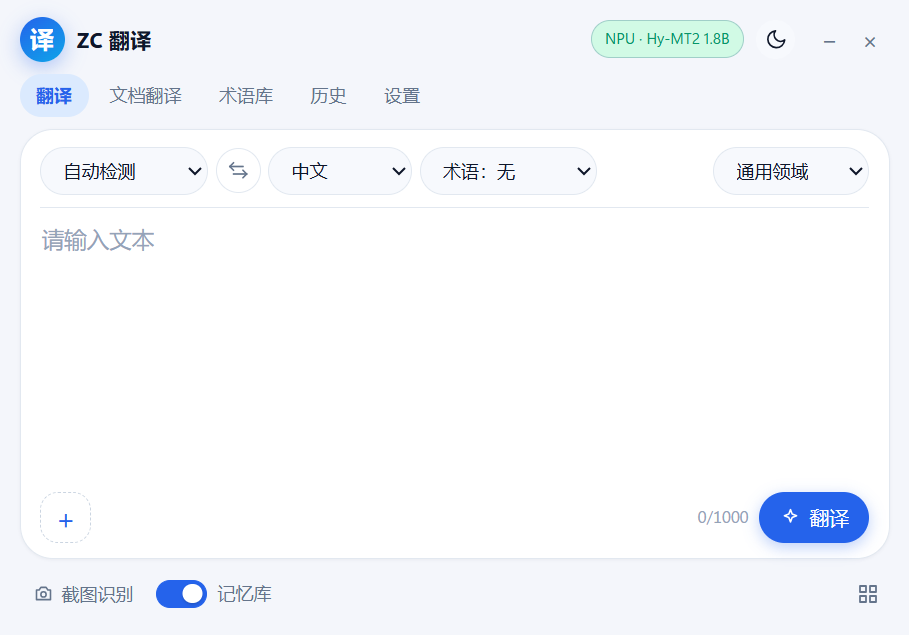
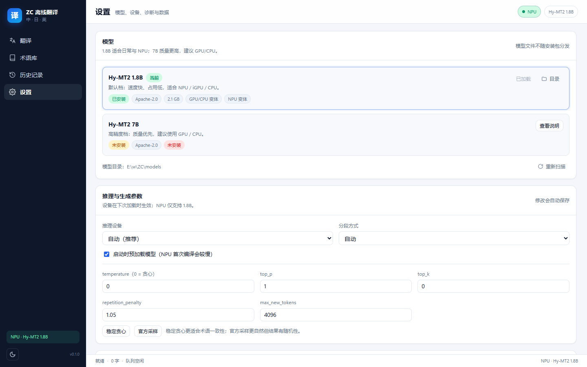
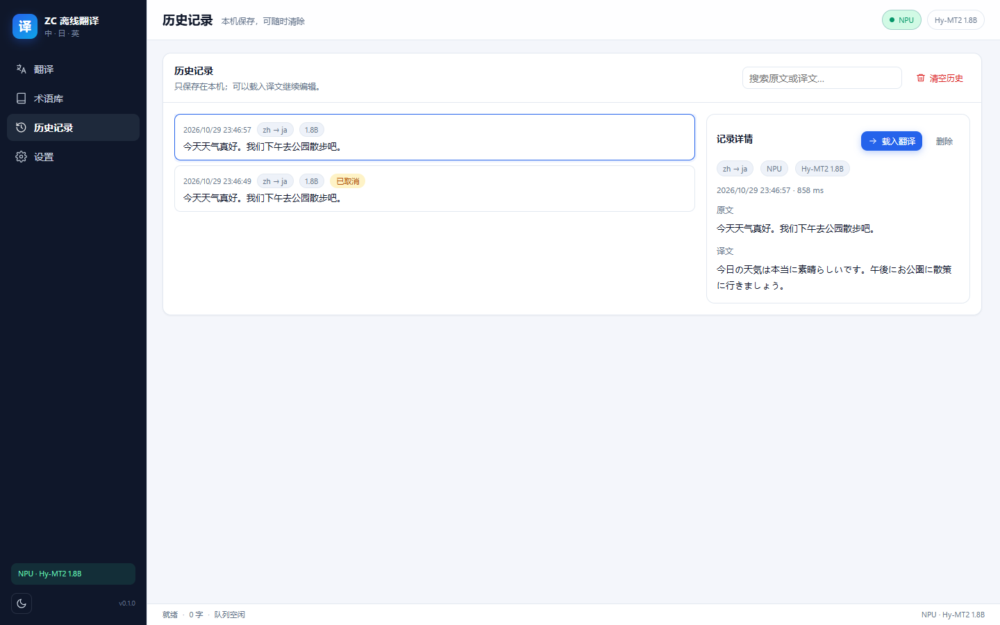

# ZC Translate (ZC 离线翻译)

> A fully **local** Chinese · Japanese · English translation desktop app: Tencent Hunyuan **Hy-MT2** (Apache-2.0) running on Intel **NPU / GPU / CPU** via **OpenVINO GenAI**, with a local FastAPI + pywebview UI. It does not access the network at runtime, except when you explicitly download models.

[简体中文](README.md) ｜ **English** ｜ [日本語](README.ja.md) ｜ [한국어](README.ko.md) ｜ [Español](README.es.md)




> **Important: neither this repository nor the release packages include translation models.** The model is 2.2–4.6 GB and must be downloaded and converted by you (or copied from a machine where it is already prepared). See [“Models: prepare and plug in your own”](#models-prepare-and-plug-in-your-own).

---

## What it is

- A translator that runs entirely on your machine: text, screenshots, images, scanned PDFs, TXT/MD, DOCX, plus voice input and select-to-translate.
- Inference uses Intel **OpenVINO GenAI** to load **OpenVINO IR** models on **NPU / GPU / CPU**, with fallback; the model stays resident and closing the window only hides it to the tray.
- Front end and back end are local: FastAPI binds `127.0.0.1` only and issues a per-launch one-time token. The UI is plain HTML/CSS/ES modules — no build step, no CDN.
- Offline by default: only “prepare model” and “download voice model” need network access.

## Features

### Translation

- Six directions between Chinese, Japanese and English; source language can be auto-detected or set manually.
- Streaming output, cancel, copy, `.txt` / `.md` import, live character count (backend limit ≈100k characters).
- Default sampling follows the model card (temperature 0.7 / top_p 0.6 / top_k 20, fixed seed); a “stable greedy” option is available.
- **Glossary**: fixed translations, bidirectional matching, case sensitivity, CSV import/export, post-translation validation.
- **Translation memory**: identical sentences (same direction / model profile / glossary) are served from cache; stored in local SQLite.
- **History**: search, view source and translation, load back into the editor, delete one or clear all.

### Screenshots, images and documents

- **Screenshot translation**: invokes the built-in Windows snipping tool (Win+Shift+S), runs local OCR, then overlays translations on top of the original text positions. Hover to peek at the source, toggle source/translation, click for a side-by-side view.
- **Image translation**: same canvas, with zoom, pan and fit-to-window.
- **Document translation**: TXT, MD, scanned PDF, DOCX; writes `originalname_翻译` **next to the original file** and never modifies the original.
- DOCX is translated paragraph by paragraph in the background with “X/Y paragraphs” progress and a cancel button; cancelling produces no partial file.
- OCR is fully local (RapidOCR + ONNX Runtime); images are never written to disk or uploaded.

### Desktop integration

- A fixed ~**620×460** rounded floating window; translation, documents, glossary, history and settings are tabs inside it.
- **Tray**: closing the window hides it; the process, database and model keep running. The tray menu can restore the window, toggle select-to-translate, or exit.
- **Select-to-translate**: when enabled, selecting text in apps that expose Windows UI Automation shows a floating translation card above the selection, growing as tokens stream in. It never simulates Ctrl+C and never modifies the clipboard.
- **Single instance**: launching again focuses the existing window instead of starting a second model.

### Voice (optional)

- **Conversation mode**: continuous microphone input; each sentence is submitted after ~2.5 s of silence while the session continues.
- **Dictation mode**: record a long passage, stop manually, and the transcript is placed in the source box for the normal translation flow.
- Uses sherpa-onnx SenseVoice (zh/ja/en/ko/yue) + Silero VAD, all locally.

### Data and privacy

- Settings, glossaries, translation memory, history and OpenVINO compile cache stay local:
  - source checkout: `data/`
  - portable build: `data/` inside the folder
  - installed build: `%LOCALAPPDATA%\ZCTranslate\`
- Logs never contain source text or translations; history and memory can be cleared; deleting `data/` resets everything.

## Screenshots

| Translation | Settings | History |
|---|---|---|
|  |  |  |

The UI is currently **Simplified Chinese only**.

## Requirements

| Item | Requirement |
|---|---|
| OS | Windows 11 x64 (Windows 10 untested) |
| Runtime | Microsoft Edge WebView2 Runtime (usually preinstalled on Windows 11) |
| From source | Python **3.12** (py launcher or python.org installer) |
| Hardware | Any Intel NPU / GPU / CPU; an NPU needs the Intel NPU driver |
| RAM | 16 GB recommended; 32 GB for the 7B profile |
| Disk | Runtime env ≈1.5 GB; 1.8B download ≈4.1 GB → output ≈2.2 GB; 7B download ≈15 GB → output ≈4.6 GB |
| Network | Only for “prepare model” / “download voice model” |

## Quick start

### Option 1: download a release (for end users)

Grab an asset from [Releases](https://github.com/2vkm2njr2y-droid/ZC-Translate/releases):

| Asset | Description |
|---|---|
| `ZCTranslate-0.1.0-win64-setup.exe` | NSIS installer: installs to `%LOCALAPPDATA%\Programs\ZCTranslate` with Start Menu shortcut and uninstaller |
| `ZCTranslate-0.1.0-win64-portable.zip` | Portable: unzip and run; settings and caches stay in the bundled `data\` |
| `SHA256SUMS.txt` | Checksums |

> **Neither package includes models.** Prepare a model as described below, otherwise the app starts but cannot translate. The installer is unsigned, so SmartScreen will show “More info → Run anyway”.

### Option 2: run from source

```powershell
git clone https://github.com/2vkm2njr2y-droid/ZC-Translate.git
cd ZC-Translate

# 1) Create both virtual environments (runtime + model conversion); requires Python 3.12
powershell -ExecutionPolicy Bypass -File scripts\setup_env.ps1

# 2) Prepare the translation model (see next section; needs network once)
.\.venv-convert\Scripts\python.exe scripts\prepare_model.py --profile balanced

# 3) OCR / scanned PDF support (optional; needed for source runs)
powershell -ExecutionPolicy Bypass -File scripts\setup_ocr.ps1

# 4) Launch
.\启动翻译器.bat          # normal launch
.\run_dev.ps1             # dev mode: console logs + DevTools
```

Once the status bar shows `NPU · Hy-MT2 1.8B` (or GPU/CPU) you can translate. `Ctrl+Enter` translates, `Esc` cancels.

## Models: prepare and plug in your own

### Why models are not in the repo

- Size: 2.2 GB (1.8B) / 4.6 GB (7B) after conversion, far above GitHub's 100 MB per-file limit.
- Models are separate works with their own licenses and distribution duties (Hy-MT2 is Apache-2.0).
- The repo only ships the download/convert/plug-in scripts and file conventions; weights are yours to fetch.

`models/` is in `.gitignore` and is never committed.

### Option A: one-command script (recommended)

```powershell
# 1.8B (default profile, NPU/GPU/CPU, ~4.1 GB download, produces two INT4 variants ≈2.2 GB)
.\.venv-convert\Scripts\python.exe scripts\prepare_model.py --profile balanced

# 7B (quality profile, GPU/CPU, ~15 GB download, ≈4.6 GB output)
.\.venv-convert\Scripts\python.exe scripts\prepare_model.py --profile quality

# Extra flags:
#   --delete-source   delete the bf16 source after conversion
#   --skip-download   reuse an existing source model
#   --force           delete existing outputs and convert again
```

The script will:

1. download `Tencent-Hunyuan/Hy-MT2-1.8B` (or `-7B`) from ModelScope into `models/<id>/source/`;
2. convert to OpenVINO IR with INT4 quantization:
   - `ov-int4`: asymmetric INT4, group 128 (GPU / CPU)
   - `ov-int4-npu`: **symmetric** INT4, per-channel (required for NPU)
3. copy `LICENSE.txt` and `MODEL_CARD.md`, and write `pack.json`.

You can also double-click **`准备模型.bat`** (equivalent to `--profile balanced`).

### Option B: manual conversion

```powershell
# Download
.\.venv-convert\Scripts\modelscope.exe download --model Tencent-Hunyuan/Hy-MT2-1.8B `
  --local_dir models\hymt2-1.8b\source

# GPU / CPU variant
.\.venv-convert\Scripts\optimum-cli.exe export openvino `
  --model models\hymt2-1.8b\source --task text-generation-with-past `
  --weight-format int4 --group-size 128 --ratio 0.8 `
  models\hymt2-1.8b\ov-int4

# NPU variant (must be symmetric, otherwise NPU compilation fails)
.\.venv-convert\Scripts\optimum-cli.exe export openvino `
  --model models\hymt2-1.8b\source --task text-generation-with-past `
  --weight-format int4 --sym --group-size -1 --ratio 1.0 `
  models\hymt2-1.8b\ov-int4-npu
```

### Option C: plug in an existing OpenVINO IR

Copy a prepared package and lay it out like this:

```
models/
└── hymt2-1.8b/                 # folder name must match model_id in MODEL_PROFILES
    ├── pack.json               # required: variants + metadata
    ├── LICENSE.txt             # recommended: model license
    ├── MODEL_CARD.md           # recommended: model card
    ├── ov-int4/
    │   ├── openvino_model.xml  # a *.xml file is required
    │   ├── openvino_model.bin
    │   └── ...tokenizer files
    └── ov-int4-npu/            # optional: without it NPU cannot be selected
        └── ...
```

`pack.json` example (exactly what the script writes):

```json
{
  "schema": 1,
  "id": "hymt2-1.8b",
  "name": "Hy-MT2 1.8B",
  "repo": "Tencent-Hunyuan/Hy-MT2-1.8B",
  "license": "Apache-2.0",
  "params": "2.0B",
  "description": "Default profile: fast and small, good for NPU / iGPU / CPU.",
  "prompt_version": "hymt2-v1",
  "openvino_version": "2026.4.1",
  "variants": {
    "default": { "path": "ov-int4", "devices": ["GPU", "CPU"] },
    "npu":     { "path": "ov-int4-npu", "devices": ["NPU"] }
  }
}
```

| Field | Meaning |
|---|---|
| `id` | Model pack id; `hymt2-1.8b` / `hymt2-7b` map to the built-in profiles |
| `variants.<key>.path` | Variant subfolder relative to the pack; must contain `openvino_model.xml` |
| `variants.<key>.devices` | Devices that may use this variant (`NPU` / `GPU` / `CPU`) |
| `license` / `repo` | Display metadata only |
| `prompt_version` | Prompt version; part of the translation-memory cache key |

Only variants declared in `pack.json` whose folders contain a `*.xml` are loaded. Without `pack.json`, the app falls back to `ov-int4` / `ov-int4-npu` folders.

### How the models folder is resolved

Fixed order (`app/backend/config.py`):

1. environment variable `ZC_MODELS_DIR`
2. `models/` next to the program (repo root or exe)
3. `models-path.txt` next to the exe (first valid line; relative paths resolve against the exe folder)
4. `models/` inside the data folder (`%LOCALAPPDATA%\ZCTranslate\models` or `data\models` in a portable build)

The portable launcher additionally looks one and two directories above for `models` and sets `ZC_MODELS_DIR` when found. Three ways to override:

```powershell
# 1) environment variable
$env:ZC_MODELS_DIR = "D:\models"

# 2) edit models-path.txt next to the exe
#    absolute path, or relative to that folder (e.g. ..\models)

# 3) command line
.\启动翻译器.bat --models-dir D:\models
```

### Limitations when plugging in a custom model

- The IR must load with OpenVINO GenAI `LLMPipeline` (`--task text-generation-with-past`) and include the tokenizer and chat template.
- **NPU only accepts symmetric INT4** (`ov-int4-npu`); asymmetric INT4 fails online partitioning on NPU.
- **Prompts are fixed to the official Hy-MT2 templates** (`prompt_version=hymt2-v1`, see `app/backend/pipeline/prompts.py`). If you swap in another model, re-validate prompts and post-processing yourself.
- **The UI exposes two profiles only**: `balanced` (`hymt2-1.8b`) and `quality` (`hymt2-7b`), defined in `MODEL_PROFILES` in `app/backend/config.py`. A custom model must either reuse those folder names or add a new profile plus matching UI exposure in `app/backend/api/models.py`.
- **No online/cloud translation API is built in.** Translation is local inference only. To use an OpenAI-compatible endpoint or a third-party MT service you would implement a new `Engine` (`app/backend/engine/base.py`) and wire it into `EngineManager` — out of scope for this version.

### Voice models (optional)

The in-app “download voice model” button fetches from `k2-fsa/sherpa-onnx` releases into `models/speech/` (network once), then works offline:

```
models/speech/
├── sherpa-onnx-sense-voice-zh-en-ja-ko-yue-int8-2024-07-17/
│   ├── model.int8.onnx
│   └── tokens.txt
└── silero_vad.onnx
```

You can also copy these files manually.

### Using models with a release package

ZIP and installer **do not** contain `models/`:

- **Portable**: put the prepared `models` folder next to `ZCTranslate.exe`, or edit the sibling `models-path.txt`.
- **Installed**: the app looks in `%LOCALAPPDATA%\ZCTranslate\models`; put the folder there or edit `models-path.txt` in the install directory.
- You can always pass `--models-dir <path>`.

## Usage cheat sheet

| Feature | Where | Notes |
|---|---|---|
| Text translation | Translate tab | Auto/manual source language; target must differ; middle button swaps |
| Screenshot | bottom button / `PrintScreen` | Requires “automatically copy to clipboard” in Windows Snipping Tool settings |
| Image / document | Documents tab | Writes `originalname_翻译`; the original is untouched; prefer 1.8B for long files |
| Glossary | Glossary tab | CSV columns: `source,target,case_sensitive,note` |
| History / memory | History tab / Settings | Local only, clearable |
| Select-to-translate | Settings or tray menu | Off by default, max 4000 chars per selection, needs UI Automation |
| Voice | microphone buttons | Optional model download; speech is still translated by Hy-MT2 |

Full guide: [docs/user-guide.md](docs/user-guide.md) (Chinese); portable notes: [docs/portable-usage.txt](docs/portable-usage.txt) (Chinese).

## Repository layout

```
app/backend/        FastAPI, OpenVINO engine, translation pipeline, SQLite, OCR/speech/document services
app/frontend/       plain HTML/CSS/ES modules (no npm, no CDN)
app/shell/          pywebview window, tray, global mouse hook, UI Automation selection
app/desktop.py      desktop launcher (random port + one-time token)
scripts/            env setup, model download/convert, diagnostics, benchmarks, evaluation, packaging, offline check
tests/              unit and integration tests; fixtures/golden evaluation set
docs/               architecture, model setup, evaluation, benchmarks, user guide, licensing
models/             OpenVINO IR model packs (gitignored, not shipped)
data/               local DB, logs, compile cache (gitignored)
assets/             icon source files
```

## Development

```powershell
# Environment (if not created yet)
powershell -ExecutionPolicy Bypass -File scripts\setup_env.ps1

# Tests / lint
.\.venv-runtime\Scripts\python -m pytest tests -q
.\.venv-runtime\Scripts\python -m ruff check app tests

# Real-engine smoke test (requires a prepared model)
.\.venv-runtime\Scripts\python scripts\smoke.py --device NPU

# Device benchmark / golden-set evaluation
.\.venv-runtime\Scripts\python scripts\benchmark.py --profiles balanced --devices NPU,GPU,CPU
.\.venv-runtime\Scripts\python scripts\evaluate.py --profile balanced --device NPU

# Offline verification
.\.venv-runtime\Scripts\python scripts\offline_check.py --device NPU

# Environment diagnostics
.\.venv-runtime\Scripts\python scripts\doctor.py
```

Architecture: [docs/architecture.md](docs/architecture.md); model details: [docs/model-setup.md](docs/model-setup.md); evaluation: [docs/evaluation.md](docs/evaluation.md); benchmarks: [docs/benchmark.md](docs/benchmark.md) (docs are in Chinese).

## Packaging and release

```powershell
# Portable folder build (dist\ZCTranslate)
powershell -ExecutionPolicy Bypass -File scripts\build_portable.ps1

# Public release: rebuild, strip local paths and data\, produce ZIP + NSIS installer
powershell -ExecutionPolicy Bypass -File scripts\build_release.ps1 -Version 0.1.0
```

- `build_portable.ps1 -Release` writes a relative `models` path into `models-path.txt`, removes `data\`, bundles `LICENSE` / `THIRD_PARTY_NOTICES.md` / all five READMEs, and adds an ASCII-only `Start-ZCTranslate.bat` fallback launcher.
- `build_release.ps1` writes to `dist\release\v<version>\`:
  - `ZCTranslate-<version>-win64-portable.zip`
  - `ZCTranslate-<version>-win64-setup.exe` (NSIS, per-user, no UAC)
  - `SHA256SUMS.txt`
- Packaged-build acceptance:

```powershell
Start-Process dist\ZCTranslate\ZCTranslate.exe -ArgumentList '--no-window --port 18031 --token verify --models-dir E:\models'
.\.venv-runtime\Scripts\python scripts\verify_package.py --base-url http://127.0.0.1:18031 --token verify --ocr
```

## Performance and accuracy

Reference machine: HONOR JGC-N / Intel Core Ultra X7 358H / 32 GB LPDDR5 9600 / Intel Arc B390 / Intel NPU / Windows 11 25H2.

| Model | Device | Load time (incl. first compile) | Throughput (50 / 500-char input) |
|---|---|---:|---:|
| Hy-MT2-1.8B INT4 | NPU | ≈13.3 s (≈1.4 s cached) | 66 / 62 tok/s |
| Hy-MT2-1.8B INT4 | GPU (Arc B390) | ≈4.2 s | 74 / 68 tok/s |
| Hy-MT2-1.8B INT4 | CPU | ≈2.8 s | 48 / 43 tok/s |
| Hy-MT2-7B INT4 | GPU (Arc B390) | ≈8 s | 21 / 20 tok/s |
| Hy-MT2-7B INT4 | CPU | ≈6 s | 15 / 14 tok/s |

> Throughput varies with input length, driver and background load; trust `python scripts/benchmark.py` on your own machine.

First golden set: 6 directions × 8 sentences (48), chrF++ (surface similarity only; human review is authoritative):

| Direction | 1.8B chrF++ | 7B chrF++ |
|---|---:|---:|
| zh→ja | 53.22 | 58.75 |
| zh→en | 79.28 | 87.24 |
| ja→zh | 46.46 | 57.51 |
| ja→en | 66.15 | 81.86 |
| en→zh | 52.46 | 55.25 |
| en→ja | 49.67 | 66.06 |
| **Average** | **57.87** | **67.78** |

7B beats 1.8B in all six directions; 1.8B is the better fit for NPU/low power, and terminology-heavy text benefits from a glossary or 7B. Details: [docs/evaluation.md](docs/evaluation.md).

## Privacy and security

- Binds `127.0.0.1` only; a random token per launch; the API checks `X-ZC-Token` and the page itself requires the token.
- CSP `default-src 'self'`, no inline scripts, no external CDN; all user text is rendered with `textContent`.
- Parameterized SQLite queries; logs never store source or translated text; screenshots stay in memory and are never written to temp files.
- History, glossaries and translation memory are local and clearable.
- Network is used only for: model preparation (ModelScope), voice model download (GitHub releases), and installing Python dependencies.

## Known limitations

- **No models are included** in the repo or release packages; the app starts but cannot translate until you prepare one.
- The UI is **Simplified Chinese only**.
- Hy-MT2-1.8B occasionally misses honorifics, technical terms or long clauses; switch to 7B or add glossary entries.
- First NPU load compiles the model (≈10–15 s on the reference machine); later loads use `data/cache` but a driver/model change recompiles.
- 7B is not recommended on NPU; translating a whole long document with 7B can take tens of minutes — use 1.8B.
- OCR/documents cover image-based or scanned PDFs, TXT/MD and DOCX; complex Word text boxes, PPTX and complex table layouts are not supported.
- Screenshot translation relies on the Windows Snipping Tool “automatically copy to clipboard” option; in browser-fallback mode the app window is not hidden while snipping.
- Select-to-translate needs Windows UI Automation: custom-drawn UIs, games, elevated windows and password fields are unsupported; keyboard Shift+arrow selection is not auto-triggered.
- Select-to-translate is off by default and capped at 4000 characters; after closing the main window use the tray to restore or exit.
- The installer is unsigned (SmartScreen warning). Uninstalling keeps `%LOCALAPPDATA%\ZCTranslate` by default.
- Custom models must reuse the built-in profile folder names or extend `MODEL_PROFILES`.

## License

- **This program: GNU Affero General Public License v3.0 (AGPL-3.0-only)** — see [LICENSE](LICENSE).
  Copyright (C) 2026 ZC Translate contributors.
- **Models: Hy-MT2-1.8B / 7B, Apache-2.0** (not distributed with this repository).
- **Third-party components**: full inventory in [THIRD_PARTY_NOTICES.md](THIRD_PARTY_NOTICES.md); compatibility analysis and redistribution checklist in [docs/licensing.md](docs/licensing.md).

Why not GPL-3.0? The PDF/scanned-document path uses **PyMuPDF (AGPL-3.0)**. GPLv3 may be combined with AGPLv3, but any package bundling PyMuPDF must also satisfy AGPL's source obligations; licensing the whole project as AGPL-3.0 is the consistent, low-friction choice. If PyMuPDF is later replaced by a permissive library such as pypdfium2, the project could switch to GPL. See [docs/licensing.md](docs/licensing.md).

## Acknowledgements

- [Tencent Hunyuan Hy-MT2](https://github.com/Tencent-Hunyuan/Hy-MT2) — translation model (Apache-2.0)
- [Intel OpenVINO / OpenVINO GenAI](https://github.com/openvinotoolkit/openvino) — local inference and model conversion
- [RapidOCR](https://github.com/RapidAI/RapidOCR) + [ONNX Runtime](https://github.com/microsoft/onnxruntime) — local OCR
- [sherpa-onnx / k2-fsa](https://github.com/k2-fsa/sherpa-onnx) — speech recognition and VAD
- [pywebview](https://github.com/r0x0r/pywebview), [FastAPI](https://github.com/fastapi/fastapi), [Uvicorn](https://github.com/encode/uvicorn)

## Contributing

- Issues and PRs are welcome. Please **do not** commit `models/`, `dist/`, `data/` or any large files.
- By submitting code you agree to license your contribution under AGPL-3.0.
- When reporting a problem include: Windows version, device (NPU/GPU/CPU), model profile, and the relevant part of `data/logs/app.log` (remove personal content first).

## Disclaimer

Machine translation can be wrong. Have legal, medical, financial or literary content reviewed by a human. This project is distributed under AGPL-3.0 without warranty.
