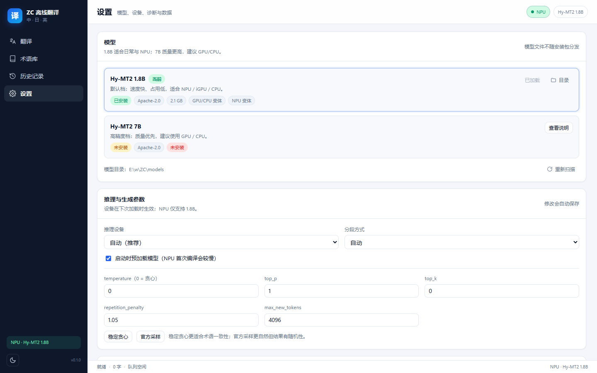
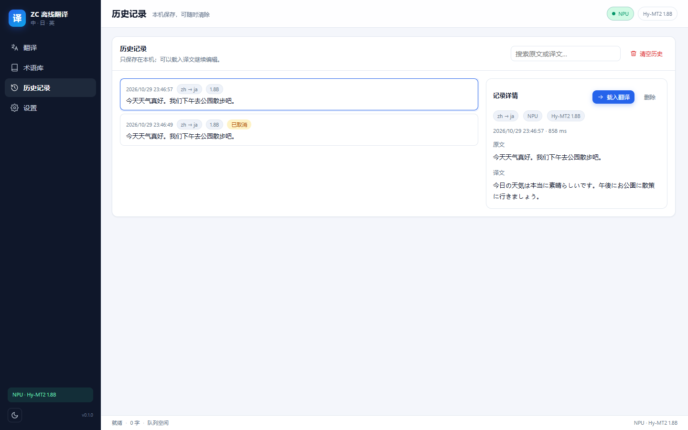

# ZC Translate (ZC 离线翻译)

> Aplicación de escritorio que traduce **chino · japonés · inglés** de forma totalmente **local**: **Hy-MT2** de Tencent Hunyuan (Apache-2.0) se ejecuta en **NPU / GPU / CPU** de Intel mediante **OpenVINO GenAI**, con una interfaz local FastAPI + pywebview. No accede a la red en tiempo de ejecución, salvo cuando tú descargas modelos de forma explícita.

[简体中文](README.md) ｜ [English](README.en.md) ｜ [日本語](README.ja.md) ｜ [한국어](README.ko.md) ｜ **Español**


> **Importante: ni este repositorio ni los paquetes de la versión incluyen modelos de traducción.** El modelo ocupa 2,2–4,6 GB y debes descargarlo y convertirlo tú mismo (o copiarlo desde una máquina donde ya esté preparado). Consulta [«Modelos: prepáralos y conéctalos tú mismo»](#modelos-prepáralos-y-conéctalos-tú-mismo).

---

## Qué es

- Un traductor que se ejecuta íntegramente en tu equipo: texto, capturas de pantalla, imágenes, PDF escaneados, TXT/MD, DOCX, además de entrada de voz y traducción de la selección.
- La inferencia usa **OpenVINO GenAI** de Intel para cargar modelos **OpenVINO IR** en **NPU / GPU / CPU**, con retroceso según la política; el modelo permanece en memoria y cerrar la ventana solo la oculta en la bandeja.
- Frontend y backend son locales: FastAPI se enlaza solo a `127.0.0.1` y emite un token de un solo uso en cada arranque. La interfaz es HTML/CSS/ES Modules sin compilación ni CDN.
- Sin conexión por defecto: solo «preparar modelo» y «descargar modelo de voz» usan la red.

## Funciones

### Traducción

- Seis direcciones entre chino, japonés e inglés; idioma de origen automático o manual.
- Salida en streaming, cancelar, copiar, importar `.txt` / `.md`, contador de caracteres en vivo (límite del backend ≈100 000 caracteres).
- Parámetros por defecto según la ficha del modelo (temperature 0.7 / top_p 0.6 / top_k 20, semilla fija); opción «greedy estable».
- **Glosario**: traducciones fijas, coincidencia bidireccional, distinción de mayúsculas, importación/exportación CSV, validación posterior.
- **Memoria de traducción**: las frases idénticas (misma dirección / modelo / glosario) se sirven desde caché; se guarda en SQLite local.
- **Historial**: buscar, ver original y traducción, recargar en el editor, borrar uno o vaciar todo.

### Capturas, imágenes y documentos

- **Traducción de capturas**: invoca la herramienta de captura de Windows (Win+Shift+S), ejecuta OCR local y superpone las traducciones sobre las posiciones del texto original. Pasa el cursor para ver el original, alterna original/traducción o haz clic para comparar.
- **Traducción de imágenes**: el mismo lienzo, con zoom, desplazamiento y ajuste a la ventana.
- **Traducción de documentos**: TXT, MD, PDF escaneado y DOCX; genera `nombreoriginal_翻译` **junto al archivo original** y nunca lo modifica.
- DOCX se traduce párrafo a párrafo en segundo plano, con progreso «X/Y párrafos» y cancelación; cancelar no deja archivos a medias.
- El OCR es totalmente local (RapidOCR + ONNX Runtime); las imágenes no se escriben en disco ni se suben.

### Integración con el escritorio

- Ventana flotante redondeada de ~**620×460**; traducción, documentos, glosario, historial y ajustes son pestañas dentro de ella.
- **Bandeja**: cerrar la ventana solo la oculta; el proceso, la base de datos y el modelo siguen activos. El menú permite restaurar, activar la traducción de selección o salir.
- **Traducción de selección**: al activarla, seleccionar texto en aplicaciones compatibles con UI Automation de Windows muestra una tarjeta flotante sobre la selección que crece con el streaming. No simula Ctrl+C ni modifica el portapapeles.
- **Instancia única**: volver a iniciar solo enfoca la ventana existente, no arranca un segundo modelo.

### Voz (opcional)

- **Modo conversación**: micrófono continuo; cada frase se envía tras ~2,5 s de silencio y la sesión continúa.
- **Modo dictado**: graba un pasaje largo, lo detienes manualmente y la transcripción se coloca en el cuadro de origen para la traducción normal.
- Usa SenseVoice de sherpa-onnx (zh/ja/en/ko/yue) + Silero VAD, todo local.

### Datos y privacidad

- Ajustes, glosarios, memoria de traducción, historial y caché de compilación de OpenVINO permanecen locales:
  - ejecución desde el código: `data/`
  - versión portable: `data/` dentro de la carpeta
  - versión instalada: `%LOCALAPPDATA%\ZCTranslate\`
- Los registros no guardan texto original ni traducciones; historial y memoria se pueden borrar; eliminar `data/` restablece todo.

## Capturas

| Traducción | Ajustes | Historial |
|---|---|---|
|  |  |  |

La interfaz está actualmente **solo en chino simplificado**.

## Requisitos

| Elemento | Requisito |
|---|---|
| SO | Windows 11 x64 (Windows 10 sin probar) |
| Runtime | Microsoft Edge WebView2 Runtime (normalmente incluido en Windows 11) |
| Desde el código | Python **3.12** (lanzador `py` o instalador de python.org) |
| Hardware | Intel NPU / GPU / CPU; la NPU requiere el controlador Intel NPU |
| RAM | 16 GB recomendados; 32 GB para el perfil 7B |
| Disco | Entorno ≈1,5 GB; 1.8B descarga ≈4,1 GB → salida ≈2,2 GB; 7B ≈15 GB → ≈4,6 GB |
| Red | Solo para «preparar modelo» / «descargar modelo de voz» |

## Inicio rápido

### Opción 1: descargar una versión (usuarios finales)

Descarga un recurso de [Releases](https://github.com/2vkm2njr2y-droid/ZC-Translate/releases):

| Recurso | Descripción |
|---|---|
| `ZCTranslate-0.1.1-win64-setup.exe` | Instalador NSIS: instala en `%LOCALAPPDATA%\Programs\ZCTranslate` con acceso en el menú Inicio y desinstalador |
| `ZCTranslate-0.1.1-win64-portable.zip` | Portable: descomprime y ejecuta; ajustes y caché quedan en `data\` |
| `SHA256SUMS.txt` | Sumas de verificación |

> **Ni el instalador ni el ZIP incluyen modelos.** Prepara uno como se explica abajo; sin modelo la aplicación arranca pero no traduce. El instalador no está firmado, así que SmartScreen mostrará «Más información → Ejecutar de todas formas».

### Opción 2: ejecutar desde el código

```powershell
git clone https://github.com/2vkm2njr2y-droid/ZC-Translate.git
cd ZC-Translate

# 1) Crear los dos entornos virtuales (ejecución + conversión de modelos); requiere Python 3.12
powershell -ExecutionPolicy Bypass -File scripts\setup_env.ps1

# 2) Preparar el modelo de traducción (ver la sección siguiente; requiere red una vez)
.\.venv-convert\Scripts\python.exe scripts\prepare_model.py --profile balanced

# 3) OCR / PDF escaneado (opcional; necesario al ejecutar desde el código)
powershell -ExecutionPolicy Bypass -File scripts\setup_ocr.ps1

# 4) Iniciar
.\启动翻译器.bat          # inicio normal (nombre de archivo en chino)
.\run_dev.ps1             # modo desarrollo: registros en consola + DevTools
```

Cuando la barra de estado muestre `NPU · Hy-MT2 1.8B` (o GPU/CPU) podrás traducir. `Ctrl+Enter` traduce, `Esc` cancela.

## Modelos: prepáralos y conéctalos tú mismo

### Por qué no hay modelos en el repositorio

- Tamaño: 2,2 GB (1.8B) / 4,6 GB (7B) tras la conversión, muy por encima del límite de 100 MB por archivo de GitHub.
- Los modelos son obras independientes con sus propias licencias y obligaciones de distribución (Hy-MT2 es Apache-2.0).
- El repositorio solo incluye los scripts y el formato para **descargar, convertir y conectar**; los pesos los obtienes tú.

`models/` está en `.gitignore` y nunca se confirma.

### Opción A: script de un solo comando (recomendado)

```powershell
# 1.8B (perfil predeterminado, NPU/GPU/CPU, descarga ≈4,1 GB, dos variantes INT4 ≈2,2 GB)
.\.venv-convert\Scripts\python.exe scripts\prepare_model.py --profile balanced

# 7B (perfil de calidad, GPU/CPU, descarga ≈15 GB, salida ≈4,6 GB)
.\.venv-convert\Scripts\python.exe scripts\prepare_model.py --profile quality

# Opciones adicionales:
#   --delete-source   borra el modelo bf16 tras convertir
#   --skip-download   reutiliza un modelo de origen existente
#   --force           borra las salidas y convierte de nuevo
```

El script:

1. descarga `Tencent-Hunyuan/Hy-MT2-1.8B` (o `-7B`) desde ModelScope en `models/<id>/source/`;
2. convierte a OpenVINO IR con cuantización INT4:
   - `ov-int4`: INT4 asimétrica, grupo 128 (GPU / CPU)
   - `ov-int4-npu`: INT4 **simétrica**, por canal (obligatoria para NPU)
3. copia `LICENSE.txt` y `MODEL_CARD.md`, y escribe `pack.json`.

También puedes hacer doble clic en **`准备模型.bat`** (equivale a `--profile balanced`).

### Opción B: conversión manual

```powershell
# Descarga
.\.venv-convert\Scripts\modelscope.exe download --model Tencent-Hunyuan/Hy-MT2-1.8B `
  --local_dir models\hymt2-1.8b\source

# Variante GPU / CPU
.\.venv-convert\Scripts\optimum-cli.exe export openvino `
  --model models\hymt2-1.8b\source --task text-generation-with-past `
  --weight-format int4 --group-size 128 --ratio 0.8 `
  models\hymt2-1.8b\ov-int4

# Variante NPU (debe ser simétrica; si no, falla la compilación en NPU)
.\.venv-convert\Scripts\optimum-cli.exe export openvino `
  --model models\hymt2-1.8b\source --task text-generation-with-past `
  --weight-format int4 --sym --group-size -1 --ratio 1.0 `
  models\hymt2-1.8b\ov-int4-npu
```

### Opción C: conectar un OpenVINO IR existente

Coloca el paquete preparado con esta estructura:

```
models/
└── hymt2-1.8b/                 # el nombre debe coincidir con model_id en MODEL_PROFILES
    ├── pack.json               # obligatorio: variantes y metadatos
    ├── LICENSE.txt             # recomendado: licencia del modelo
    ├── MODEL_CARD.md           # recomendado: ficha del modelo
    ├── ov-int4/
    │   ├── openvino_model.xml  # debe existir un *.xml
    │   ├── openvino_model.bin
    │   └── ...archivos del tokenizador
    └── ov-int4-npu/            # opcional: sin esto no se puede elegir NPU
        └── ...
```

Ejemplo de `pack.json` (exactamente lo que escribe el script):

```json
{
  "schema": 1,
  "id": "hymt2-1.8b",
  "name": "Hy-MT2 1.8B",
  "repo": "Tencent-Hunyuan/Hy-MT2-1.8B",
  "license": "Apache-2.0",
  "params": "2.0B",
  "description": "Perfil predeterminado: rápido y ligero, para NPU / iGPU / CPU.",
  "prompt_version": "hymt2-v1",
  "openvino_version": "2026.4.1",
  "variants": {
    "default": { "path": "ov-int4", "devices": ["GPU", "CPU"] },
    "npu":     { "path": "ov-int4-npu", "devices": ["NPU"] }
  }
}
```

| Campo | Significado |
|---|---|
| `id` | ID del paquete; `hymt2-1.8b` / `hymt2-7b` corresponden a los perfiles integrados |
| `variants.<key>.path` | Subcarpeta relativa al paquete; debe contener `openvino_model.xml` |
| `variants.<key>.devices` | Dispositivos que pueden usar la variante (`NPU` / `GPU` / `CPU`) |
| `license` / `repo` | Metadatos de visualización |
| `prompt_version` | Versión del prompt; forma parte de la clave de caché de la memoria |

Solo se cargan las variantes declaradas en `pack.json` cuya carpeta contenga un `*.xml`. Sin `pack.json`, se buscan las carpetas `ov-int4` / `ov-int4-npu`.

### Cómo se resuelve la carpeta de modelos

Orden fijo (`app/backend/config.py`):

1. variable de entorno `ZC_MODELS_DIR`
2. `models/` junto al programa (raíz del repositorio o junto al exe)
3. `models-path.txt` junto al exe (primera línea válida; las rutas relativas se resuelven respecto al exe)
4. `models/` dentro de la carpeta de datos (`%LOCALAPPDATA%\ZCTranslate\models` o `data\models` en portable)

El lanzador portable también busca `models` uno y dos niveles arriba y define `ZC_MODELS_DIR` si lo encuentra. Tres formas de sobrescribirlo:

```powershell
# 1) variable de entorno
$env:ZC_MODELS_DIR = "D:\models"

# 2) editar models-path.txt junto al exe
#    ruta absoluta o relativa a esa carpeta (p. ej. ..\models)

# 3) argumento de línea de comandos
.\启动翻译器.bat --models-dir D:\models
```

### Limitaciones al conectar un modelo propio

- Debe ser un IR que cargue OpenVINO GenAI `LLMPipeline` (`--task text-generation-with-past`) e incluir el tokenizador y la plantilla de chat.
- **La NPU solo acepta INT4 simétrica** (`ov-int4-npu`); la asimétrica provoca un error de partición en línea en la NPU.
- **Los prompts están fijados a las plantillas oficiales de Hy-MT2** (`prompt_version=hymt2-v1`, ver `app/backend/pipeline/prompts.py`). Si cambias de modelo, valida tú mismo los prompts y el posprocesado.
- **La interfaz solo expone dos perfiles**: `balanced` (`hymt2-1.8b`) y `quality` (`hymt2-7b`), definidos en `MODEL_PROFILES` en `app/backend/config.py`. Un modelo propio debe reutilizar esos nombres de carpeta o añadir un perfil y su exposición en `app/backend/api/models.py`.
- **No hay ninguna API de traducción en línea/en la nube integrada.** La traducción es solo inferencia local. Para usar un endpoint compatible con OpenAI o un servicio externo habría que implementar un nuevo `Engine` (`app/backend/engine/base.py`) y conectarlo a `EngineManager`; queda fuera del alcance de esta versión.

### Modelos de voz (opcional)

El botón «descargar modelo de voz» de la aplicación descarga desde las releases de `k2-fsa/sherpa-onnx` en `models/speech/` (red una vez) y luego funciona sin conexión:

```
models/speech/
├── sherpa-onnx-sense-voice-zh-en-ja-ko-yue-int8-2024-07-17/
│   ├── model.int8.onnx
│   └── tokens.txt
└── silero_vad.onnx
```

También puedes copiar esos archivos manualmente.

### Uso de modelos con un paquete publicado

El ZIP y el instalador **no** incluyen `models/`:

- **Portable**: coloca la carpeta `models` preparada junto a `ZCTranslate.exe` o edita el `models-path.txt` contiguo.
- **Instalado**: la aplicación busca en `%LOCALAPPDATA%\ZCTranslate\models`; colócala allí o edita `models-path.txt` en la carpeta de instalación.
- Siempre puedes pasar `--models-dir <ruta>`.

## Guía rápida de uso

| Función | Dónde | Notas |
|---|---|---|
| Traducción de texto | pestaña Traducción | Idioma de origen automático/manual; el destino no puede ser igual; el botón central intercambia |
| Captura de pantalla | botón inferior / `PrintScreen` | Requiere «copiar automáticamente al portapapeles» en la Herramienta de recortes de Windows |
| Imagen / documento | pestaña Documentos | Genera `nombreoriginal_翻译`; el original no se toca; usa 1.8B para archivos largos |
| Glosario | pestaña Glosario | Columnas CSV: `source,target,case_sensitive,note` |
| Historial / memoria | pestaña Historial / Ajustes | Solo local, se puede vaciar |
| Traducción de selección | Ajustes o menú de bandeja | Desactivada por defecto, máx. 4000 caracteres, requiere UI Automation |
| Voz | botones de micrófono | Descarga opcional del modelo; el texto se traduce con Hy-MT2 |

Guía completa: [docs/user-guide.md](docs/user-guide.md) (en chino); notas del portable: [docs/portable-usage.txt](docs/portable-usage.txt) (en chino).

## Estructura del repositorio

```
app/backend/        FastAPI, motor OpenVINO, canalización de traducción, SQLite, OCR/voz/documentos
app/frontend/       HTML/CSS/ES Modules sin compilación (sin npm, sin CDN)
app/shell/          ventana pywebview, bandeja, gancho global del ratón, UI Automation
app/desktop.py      lanzador de escritorio (puerto aleatorio + token de un solo uso)
scripts/            entorno, descarga/conversión de modelos, diagnóstico, benchmarks, evaluación, empaquetado
tests/              pruebas unitarias e integrales; fixtures/golden
docs/               arquitectura, modelos, evaluación, benchmarks, guía de usuario, licencias
models/             paquetes OpenVINO IR (gitignore, no se distribuyen)
data/               base de datos, registros, caché de compilación (gitignore)
assets/             archivos de origen de los iconos
```

## Desarrollo

```powershell
# Entorno (si aún no existe)
powershell -ExecutionPolicy Bypass -File scripts\setup_env.ps1

# Pruebas / análisis estático
.\.venv-runtime\Scripts\python -m pytest tests -q
.\.venv-runtime\Scripts\python -m ruff check app tests

# Prueba real del motor (requiere modelo preparado)
.\.venv-runtime\Scripts\python scripts\smoke.py --device NPU

# Benchmark por dispositivo / evaluación del conjunto dorado
.\.venv-runtime\Scripts\python scripts\benchmark.py --profiles balanced --devices NPU,GPU,CPU
.\.venv-runtime\Scripts\python scripts\evaluate.py --profile balanced --device NPU

# Verificación sin conexión
.\.venv-runtime\Scripts\python scripts\offline_check.py --device NPU

# Diagnóstico del entorno
.\.venv-runtime\Scripts\python scripts\doctor.py
```

Arquitectura: [docs/architecture.md](docs/architecture.md); modelos: [docs/model-setup.md](docs/model-setup.md); evaluación: [docs/evaluation.md](docs/evaluation.md); benchmarks: [docs/benchmark.md](docs/benchmark.md) (documentación en chino).

## Empaquetado y publicación

```powershell
# Versión portable (dist\ZCTranslate)
powershell -ExecutionPolicy Bypass -File scripts\build_portable.ps1

# Publicación: recompilar, quitar rutas locales y data\, generar ZIP + instalador NSIS
powershell -ExecutionPolicy Bypass -File scripts\build_release.ps1 -Version 0.1.1
```

- `build_portable.ps1 -Release` escribe la ruta relativa `models` en `models-path.txt`, elimina `data\`, incluye `LICENSE` / `THIRD_PARTY_NOTICES.md` / los cinco README y añade un lanzador ASCII `Start-ZCTranslate.bat` de respaldo.
- `build_release.ps1` genera en `dist\release\v<version>\`:
  - `ZCTranslate-<version>-win64-portable.zip`
  - `ZCTranslate-<version>-win64-setup.exe` (NSIS, instalación por usuario, sin UAC)
  - `SHA256SUMS.txt`
- Verificación del paquete:

```powershell
Start-Process dist\ZCTranslate\ZCTranslate.exe -ArgumentList '--no-window --port 18031 --token verify --models-dir E:\models'
.\.venv-runtime\Scripts\python scripts\verify_package.py --base-url http://127.0.0.1:18031 --token verify --ocr
```

## Rendimiento y precisión

Equipo de referencia: HONOR JGC-N / Intel Core Ultra X7 358H / 32 GB LPDDR5 9600 / Intel Arc B390 / Intel NPU / Windows 11 25H2.

| Modelo | Dispositivo | Tiempo de carga (con primera compilación) | Velocidad (entrada de 50 / 500 caracteres) |
|---|---|---:|---:|
| Hy-MT2-1.8B INT4 | NPU | ≈13,3 s (≈1,4 s con caché) | 66 / 62 tok/s |
| Hy-MT2-1.8B INT4 | GPU (Arc B390) | ≈4,2 s | 74 / 68 tok/s |
| Hy-MT2-1.8B INT4 | CPU | ≈2,8 s | 48 / 43 tok/s |
| Hy-MT2-7B INT4 | GPU (Arc B390) | ≈8 s | 21 / 20 tok/s |
| Hy-MT2-7B INT4 | CPU | ≈6 s | 15 / 14 tok/s |

> La velocidad varía con la longitud de entrada, el controlador y la carga de fondo; en tu equipo fíate de `python scripts/benchmark.py`.

Conjunto dorado inicial: 6 direcciones × 8 frases (48), métrica chrF++ (solo similitud superficial; la revisión humana manda):

| Dirección | 1.8B chrF++ | 7B chrF++ |
|---|---:|---:|
| zh→ja | 53.22 | 58.75 |
| zh→en | 79.28 | 87.24 |
| ja→zh | 46.46 | 57.51 |
| ja→en | 66.15 | 81.86 |
| en→zh | 52.46 | 55.25 |
| en→ja | 49.67 | 66.06 |
| **Media** | **57.87** | **67.78** |

7B supera a 1.8B en las seis direcciones; 1.8B encaja mejor en NPU/bajo consumo, y el texto con mucha terminología se beneficia de un glosario o de 7B. Detalles: [docs/evaluation.md](docs/evaluation.md).

## Privacidad y seguridad

- Se enlaza solo a `127.0.0.1`; token aleatorio por arranque; la API comprueba `X-ZC-Token` y la propia página lo requiere.
- CSP `default-src 'self'`, sin scripts en línea ni CDN externo; todo el texto del usuario se renderiza con `textContent`.
- Consultas SQLite parametrizadas; los registros no almacenan original ni traducción; las capturas permanecen en memoria y no se escriben archivos temporales.
- Historial, glosarios y memoria de traducción son locales y se pueden borrar.
- La red solo se usa para: preparar el modelo (ModelScope), descargar el modelo de voz (GitHub Releases) e instalar dependencias de Python.

## Limitaciones conocidas

- **No se incluyen modelos** en el repositorio ni en los paquetes; la aplicación arranca pero no traduce hasta que prepares uno.
- La interfaz está **solo en chino simplificado**.
- Hy-MT2-1.8B a veces omite honoríficos, términos técnicos o cláusulas largas; cambia a 7B o añade entradas al glosario.
- La primera carga en NPU compila el modelo (≈10–15 s en el equipo de referencia); después usa `data/cache`, pero cambiar controlador o modelo recompila.
- No se recomienda 7B en NPU; traducir un documento largo con 7B puede tardar decenas de minutos: usa 1.8B.
- El OCR y los documentos cubren PDF de imagen o escaneados, TXT/MD y DOCX; no se admiten cuadros de texto complejos de Word, PPTX ni tablas complejas.
- La traducción de capturas depende de la opción «copiar automáticamente al portapapeles» de la Herramienta de recortes; en modo navegador la ventana no se oculta al capturar.
- La traducción de selección requiere UI Automation de Windows: no funciona en interfaces dibujadas a mano, juegos, ventanas con privilegios ni campos de contraseña; la selección con Shift+flechas no se activa automáticamente.
- La traducción de selección está desactivada por defecto y limitada a 4000 caracteres; tras cerrar la ventana principal usa la bandeja para restaurar o salir.
- El instalador no está firmado (aviso de SmartScreen). Al desinstalar se conserva `%LOCALAPPDATA%\ZCTranslate` por defecto.
- Los modelos propios deben reutilizar los nombres de carpeta de los perfiles integrados o ampliar `MODEL_PROFILES`.

## Licencia

- **Este programa: GNU Affero General Public License v3.0 (AGPL-3.0-only)** — consulta [LICENSE](LICENSE).
  Copyright (C) 2026 ZC Translate contributors.
- **Modelos: Hy-MT2-1.8B / 7B, Apache-2.0** (no se distribuyen con este repositorio).
- **Componentes de terceros**: inventario completo en [THIRD_PARTY_NOTICES.md](THIRD_PARTY_NOTICES.md); análisis de compatibilidad y lista de verificación para redistribuir en [docs/licensing.md](docs/licensing.md).

¿Por qué no GPL-3.0? La ruta de PDF/documentos escaneados usa **PyMuPDF (AGPL-3.0)**. GPLv3 puede combinarse con AGPLv3, pero cualquier paquete que incluya PyMuPDF debe cumplir también las obligaciones de código fuente de AGPL; licenciar todo el proyecto como AGPL-3.0 es la opción coherente y sencilla. Si en el futuro se sustituye PyMuPDF por una biblioteca permisiva como pypdfium2, el proyecto podría pasar a GPL. Ver [docs/licensing.md](docs/licensing.md).

## Agradecimientos

- [Tencent Hunyuan Hy-MT2](https://github.com/Tencent-Hunyuan/Hy-MT2) — modelo de traducción (Apache-2.0)
- [Intel OpenVINO / OpenVINO GenAI](https://github.com/openvinotoolkit/openvino) — inferencia local y conversión de modelos
- [RapidOCR](https://github.com/RapidAI/RapidOCR) + [ONNX Runtime](https://github.com/microsoft/onnxruntime) — OCR local
- [sherpa-onnx / k2-fsa](https://github.com/k2-fsa/sherpa-onnx) — reconocimiento de voz y VAD
- [pywebview](https://github.com/r0x0r/pywebview), [FastAPI](https://github.com/fastapi/fastapi), [Uvicorn](https://github.com/encode/uvicorn)

## Contribuir

- Se aceptan issues y PR. **No** confirmes `models/`, `dist/`, `data/` ni archivos grandes.
- Al enviar código aceptas licenciar tu contribución bajo AGPL-3.0.
- Al reportar un problema incluye: versión de Windows, dispositivo (NPU/GPU/CPU), perfil de modelo y la parte relevante de `data/logs/app.log` (elimina antes los datos personales).

## Descargo de responsabilidad

La traducción automática puede equivocarse. Haz revisar por una persona el contenido legal, médico, financiero o literario. Este proyecto se distribuye bajo AGPL-3.0 sin garantía.
