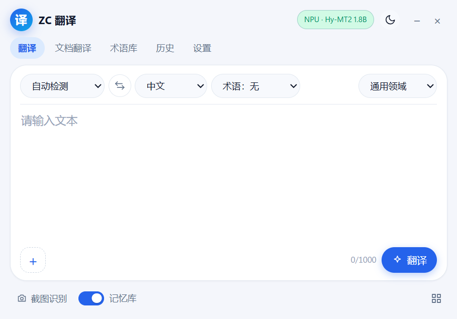

# ZC Translate

ZC Translate es una aplicación de escritorio para Windows que traduce entre chino, japonés e inglés. Ejecuta el modelo Hy-MT2 de Tencent Hunyuan en local sobre Intel NPU, GPU o CPU mediante OpenVINO. La interfaz es una pequeña ventana de pywebview y el backend usa FastAPI. Salvo para preparar el modelo de traducción y descargar el modelo de voz, no necesita conexión; el texto original y las traducciones se quedan en tu equipo.

[简体中文](README.md) ｜ [English](README.en.md) ｜ [日本語](README.ja.md) ｜ [한국어](README.ko.md) ｜ **Español**



## Funciones

- Seis direcciones entre chino, japonés e inglés. El idioma de origen se puede detectar automáticamente o elegir a mano, y la traducción se muestra en streaming para poder cancelarla en cualquier momento.
- La traducción de capturas usa la herramienta de recorte de Windows, ejecuta OCR en local y pinta la traducción sobre el texto original. La traducción de imágenes usa el mismo lienzo, con zoom y desplazamiento.
- La traducción de documentos admite TXT, Markdown, PDF escaneado y DOCX. El resultado se guarda junto al original como `nombreoriginal_翻译`, y el archivo original no se modifica.
- La traducción de selección funciona en aplicaciones compatibles con UI Automation de Windows. Al seleccionar texto aparece una tarjeta con la traducción encima de la selección. No simula Ctrl+C ni toca el portapapeles.
- La entrada de voz admite modos de conversación y dictado, y usa SenseVoice y Silero VAD de sherpa-onnx. El reconocimiento y la traducción se hacen en local; el modelo de voz se descarga aparte.
- Los glosarios, la memoria de traducción y el historial se guardan en una base SQLite local. Los glosarios admiten importación/exportación CSV y búsqueda, el historial se puede buscar y la memoria de traducción se consulta automáticamente y se puede borrar en los ajustes.

## Requisitos

- Windows 11 x64. Windows 10 no se ha probado.
- Microsoft Edge WebView2 Runtime, normalmente ya instalado en Windows 11.
- Intel NPU, GPU o CPU. Para usar la NPU hace falta el controlador Intel NPU.
- 16 GB de RAM recomendados; 32 GB para el perfil 7B.
- Disco: unos 1,5 GB para el entorno. El modelo 1.8B descarga unos 4,1 GB y ocupa unos 2,2 GB tras convertir; el 7B descarga unos 15 GB y ocupa unos 4,6 GB.
- Python 3.12 para ejecutar desde el código.

## Descarga

Descarga una versión desde [Releases](https://github.com/2vkm2njr2y-droid/ZC-Translate/releases):

- `ZCTranslate-0.1.2-win64-setup.exe`: instalador NSIS para el usuario actual, sin permisos de administrador.
- `ZCTranslate-0.1.2-win64-portable.zip`: versión portable; se descomprime y se ejecuta, y los ajustes y la caché quedan dentro de la carpeta.
- `SHA256SUMS.txt`: sumas de verificación de los dos paquetes.

Ninguno de los dos incluye un modelo. El instalador no está firmado, así que SmartScreen pedirá «Más información → Ejecutar de todas formas». Las notas de la versión portable están en [docs/portable-usage.txt](docs/portable-usage.txt) (en chino).

## Preparar el modelo

El modelo convertido es demasiado grande para GitHub, así que el repositorio y los paquetes solo incluyen los scripts de descarga y conversión, no los pesos. Hay que prepararlo una vez antes del primer uso; este paso necesita conexión.

La conversión usa el entorno `.venv-convert` del repositorio. Si todavía no existe, ejecuta primero `scripts\setup_env.ps1` de la sección siguiente (en ese paso no hace falta un modelo) y vuelve aquí:

```powershell
# 1.8B, perfil predeterminado, NPU / GPU / CPU
.\.venv-convert\Scripts\python.exe scripts\prepare_model.py --profile balanced

# 7B, perfil de calidad, GPU o CPU recomendados
.\.venv-convert\Scripts\python.exe scripts\prepare_model.py --profile quality
```

También puedes hacer doble clic en `准备模型.bat`, que equivale a `--profile balanced`.

El script descarga Hy-MT2 desde ModelScope, lo convierte a OpenVINO IR, aplica cuantización INT4 y crea esta estructura bajo `models/`:

```
models/
└── hymt2-1.8b/
    ├── pack.json
    ├── LICENSE.txt
    ├── MODEL_CARD.md
    ├── ov-int4/          # GPU / CPU
    └── ov-int4-npu/      # NPU; debe usar cuantización simétrica
```

`ov-int4-npu` es la variante INT4 simétrica que exige la NPU; la cuantización asimétrica no compila en ella. La primera carga en NPU compila el modelo (unos 10–15 segundos en el equipo de referencia) y después se lee de `data/cache`.

La aplicación busca los modelos en este orden: la variable de entorno `ZC_MODELS_DIR`, `models/` junto al programa, `models-path.txt` junto al ejecutable y `models/` en la carpeta de datos. El lanzador portable también mira una o dos carpetas por encima. Siempre puedes pasar `--models-dir <ruta>`.

En la versión portable, coloca `models` junto a `ZCTranslate.exe`; en la instalada, en `%LOCALAPPDATA%\ZCTranslate\models`. Ambas aceptan `--models-dir` para cambiarlo.

La conversión manual, la conexión de un OpenVINO IR existente y los límites de los modelos propios están en [docs/model-setup.md](docs/model-setup.md) (en chino).

## Ejecutar desde el código

```powershell
git clone https://github.com/2vkm2njr2y-droid/ZC-Translate.git
cd ZC-Translate

# Entornos de ejecución y de conversión; requiere Python 3.12
powershell -ExecutionPolicy Bypass -File scripts\setup_env.ps1

# Preparar el modelo; consulta la sección anterior
.\.venv-convert\Scripts\python.exe scripts\prepare_model.py --profile balanced

# OCR y PDF escaneado, opcional
powershell -ExecutionPolicy Bypass -File scripts\setup_ocr.ps1

# Iniciar
.\启动翻译器.bat
```

`run_dev.ps1` es el modo de desarrollo: muestra los registros en la consola y abre DevTools.

Pruebas y análisis estático:

```powershell
.\.venv-runtime\Scripts\python -m pytest tests -q
.\.venv-runtime\Scripts\python -m ruff check app tests
```

Las compilaciones de release se generan con `scripts\build_release.ps1`; las notas de arquitectura están en [docs/architecture.md](docs/architecture.md) (en chino).

## Uso

Al abrir la aplicación, la barra de estado muestra el dispositivo y el modelo actuales. `Ctrl+Enter` traduce y `Esc` cancela.

- Traducción de capturas: botón «截图翻译» de la parte inferior o `PrintScreen`. Hay que activar «copiar automáticamente al portapapeles» en la Herramienta de recortes de Windows.
- Traducción de documentos: pestaña «文档翻译». Para documentos largos se recomienda 1.8B; 7B es más preciso pero mucho más lento.
- Traducción de selección: se activa en los ajustes. Está desactivada por defecto y admite 4000 caracteres por selección.
- Glosario: las columnas del CSV son `source,target,case_sensitive,note`.

La guía completa y las preguntas frecuentes están en [docs/user-guide.md](docs/user-guide.md) (en chino).

## Rendimiento

Equipo de referencia: HONOR JGC-N, Core Ultra X7 358H, 32 GB LPDDR5, Arc B390, Windows 11 25H2.

| Modelo | Dispositivo | Tiempo de carga | Velocidad (50 / 500 caracteres) |
|---|---|---:|---:|
| Hy-MT2 1.8B INT4 | NPU | unos 13,3 s (1,4 s con caché) | 66 / 62 tok/s |
| Hy-MT2 1.8B INT4 | GPU | unos 4,2 s | 74 / 68 tok/s |
| Hy-MT2 1.8B INT4 | CPU | unos 2,8 s | 48 / 43 tok/s |
| Hy-MT2 7B INT4 | GPU | unos 8 s | 21 / 20 tok/s |
| Hy-MT2 7B INT4 | CPU | unos 6 s | 15 / 14 tok/s |

La velocidad varía con la longitud de entrada, el controlador y la carga de fondo. Los datos completos y el método de evaluación están en [docs/benchmark.md](docs/benchmark.md) y [docs/evaluation.md](docs/evaluation.md) (en chino).

## Limitaciones

- La interfaz solo está en chino simplificado.
- El modelo 1.8B a veces omite honoríficos, términos técnicos o cláusulas largas; puedes cambiar a 7B o usar un glosario.
- No se recomienda 7B en NPU; traducir un documento largo con 7B puede tardar decenas de minutos.
- La primera carga en NPU compila el modelo; cambiar el controlador o el modelo obliga a recompilar.
- La traducción de selección depende de UI Automation: no funciona en interfaces dibujadas a mano, juegos, ventanas con permisos de administrador ni campos de contraseña.
- El instalador no está firmado. Al desinstalar la versión instalada se conservan los ajustes, el historial y los modelos en `%LOCALAPPDATA%\ZCTranslate`.
- La traducción automática puede equivocarse. Haz revisar por una persona el contenido legal, médico, financiero o literario.

## Privacidad

FastAPI solo escucha en `127.0.0.1` y genera un token de un solo uso en cada arranque. Los registros no guardan el texto original ni las traducciones, y las capturas se procesan solo en memoria, sin archivos temporales. El historial, los glosarios y la memoria de traducción se pueden borrar de una vez.

## Licencia

Este proyecto se distribuye bajo la GNU Affero General Public License v3.0 (AGPL-3.0-only). Copyright (C) 2026 ZC Translate contributors. El texto completo está en [LICENSE](LICENSE), el aviso de copyright y garantía en [NOTICE](NOTICE), y los componentes de terceros en [THIRD_PARTY_NOTICES.md](THIRD_PARTY_NOTICES.md).

El modelo Hy-MT2 usa Apache-2.0 y no se distribuye con este repositorio. Los modelos de voz los descarga el usuario dentro de la aplicación y tienen sus propias licencias.

## Agradecimientos

- [Tencent Hunyuan Hy-MT2](https://github.com/Tencent-Hunyuan/Hy-MT2): modelo de traducción
- [Intel OpenVINO / OpenVINO GenAI](https://github.com/openvinotoolkit/openvino): inferencia y conversión de modelos
- [RapidOCR](https://github.com/RapidAI/RapidOCR) + [ONNX Runtime](https://github.com/microsoft/onnxruntime): OCR local
- [sherpa-onnx](https://github.com/k2-fsa/sherpa-onnx): reconocimiento de voz y VAD
- [pywebview](https://github.com/r0x0r/pywebview), [FastAPI](https://github.com/fastapi/fastapi), [Uvicorn](https://github.com/encode/uvicorn)

Se aceptan issues y pull requests. No subas `models/`, `dist/`, `data/` ni datos personales que aparezcan en los registros.
