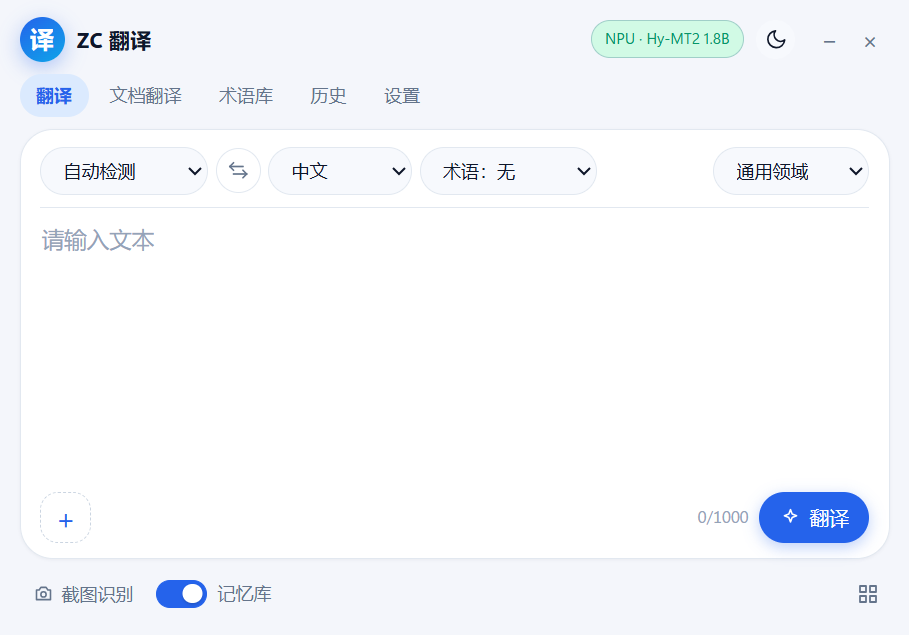
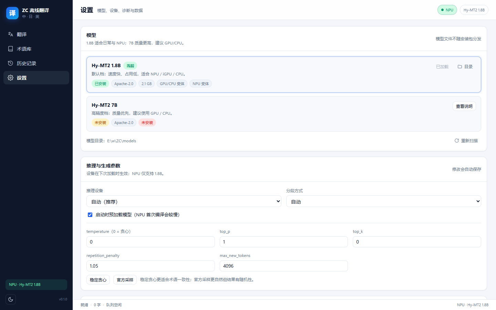
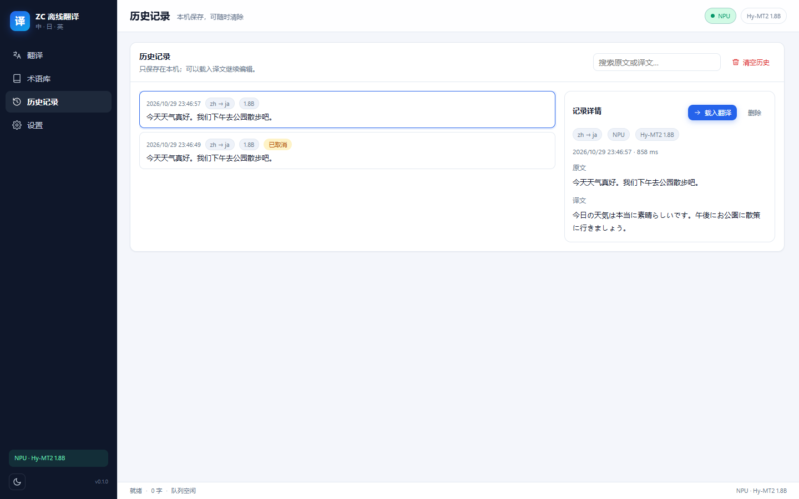

# ZC オフライン翻訳（ZC Translate）

> **中国語・日本語・英語**をローカルで翻訳するデスクトップアプリ。Tencent Hunyuan **Hy-MT2**（Apache-2.0）を **OpenVINO GenAI** 経由で Intel **NPU / GPU / CPU** 上で推論し、UI はローカルの FastAPI + pywebview。ユーザーが明示的にモデルをダウンロードする場合を除き、実行時にネットワークへアクセスしません。

[简体中文](README.md) ｜ [English](README.en.md) ｜ **日本語** ｜ [한국어](README.ko.md) ｜ [Español](README.es.md)




> **重要：このリポジトリにもリリースパッケージにも翻訳モデルは含まれていません。** モデルは 2.2〜4.6 GB あり、ご自身でダウンロード・変換する（または準備済みの環境からコピーする）必要があります。詳しくは[「モデルは自分で準備して接続する」](#モデルは自分で準備して接続する)をご覧ください。

---

## これは何か

- 完全にローカルで動く翻訳ツール：テキスト、スクリーンショット、画像、スキャン PDF、TXT/MD、DOCX、音声入力、選択範囲の翻訳。
- 推論は Intel **OpenVINO GenAI** が **OpenVINO IR** モデルを読み込み、**NPU / GPU / CPU** を選択可能。失敗時はポリシーに従ってフォールバックし、モデルはメモリに常駐します（ウィンドウを閉じてもトレイに残ります）。
- フロントエンドもバックエンドもローカル：FastAPI は `127.0.0.1` のみにバインドし、起動ごとにワンタイムトークンを発行。UI はビルド不要・CDN なしの素の HTML/CSS/ES Modules。
- 既定でオフライン：「モデル準備」と「音声モデルのダウンロード」のみネットワークを使います。

## 機能

### 翻訳

- 中国語・日本語・英語の 6 方向。原文言語は自動判定または手動指定。
- ストリーミング表示、キャンセル、コピー、`.txt` / `.md` の読み込み、文字数のリアルタイム表示（バックエンド上限は約 10 万文字）。
- 生成パラメータはモデルカード推奨値（temperature 0.7 / top_p 0.6 / top_k 20、乱数シード固定）。「安定貪欲法」も選択可。
- **用語集**：固定訳、双方向マッチ、大文字小文字の区別、CSV 入出力、翻訳後のヒット検証。
- **翻訳メモリ**：同一文（同じ方向・同じモデル・同じ用語集）はモデルを呼ばずに再利用。ローカル SQLite に保存。
- **履歴**：検索、原文と訳文の表示、エディタへの再読み込み、1 件削除、全消去。

### スクリーンショット・画像・文書

- **スクリーンショット翻訳**：Windows 標準の切り取り（Win+Shift+S）を呼び出し、ローカル OCR の結果に基づいて訳文を元の文字位置に重ねます。ホバーで原文、原文/訳文の一括切替、クリックで対訳表示。
- **画像翻訳**：同じキャンバスで、ズーム・パン・ウィンドウに合わせる操作に対応。
- **文書翻訳**：TXT、MD、スキャン PDF、DOCX。**元ファイルと同じフォルダ**に `元ファイル名_翻译` を生成し、元ファイルは変更しません。
- DOCX はバックグラウンドで段落ごとに翻訳し、「X/Y 段落」の進捗とキャンセルを提供。キャンセル時は中途半端なファイルを残しません。
- OCR は完全ローカル（RapidOCR + ONNX Runtime）。画像はディスクに保存せず、アップロードもしません。

### デスクトップ統合

- 約 **620×460** の固定された角丸フローティングウィンドウ。翻訳／文書翻訳／用語集／履歴／設定を上部タブで切り替えます。
- **トレイ**：ウィンドウを閉じても非表示になるだけで、プロセス・DB・モデルは動作継続。トレイメニューから復元、選択範囲翻訳の切替、終了が可能。
- **選択範囲翻訳**：有効にすると、Windows UI Automation に対応したアプリで文字を選択した際、選択位置の上に翻訳カードを表示し、ストリーミングで高さが伸びます。Ctrl+C の模擬やクリップボードの書き換えは行いません。
- **単一インスタンス**：再度起動しても既存ウィンドウを呼び出すだけで、2 つ目のモデルは起動しません。

### 音声（任意）

- **会話モード**：マイク入力を継続し、約 2.5 秒の無音でその 1 文だけを送信、セッションは継続。
- **音声入力モード**：長い文章を録音し、手動停止後に認識結果を原文欄へ挿入してから通常の翻訳を実行。
- sherpa-onnx の SenseVoice（中/日/英/韓/広東語）+ Silero VAD を使用し、すべてローカル。

### データとプライバシー

- 設定、用語集、翻訳メモリ、履歴、OpenVINO のコンパイルキャッシュはすべてローカル：
  - ソース実行：リポジトリ内 `data/`
  - ポータブル版：フォルダ内 `data/`
  - インストール版：`%LOCALAPPDATA%\ZCTranslate\`
- ログに原文・訳文は記録しません。履歴とメモリは一括消去可能。`data/` を削除すれば初期化されます。

## 画面

| 翻訳 | 設定 | 履歴 |
|---|---|---|
|  |  |  |

UI は現在**簡体字中国語のみ**です。

## 動作要件

| 項目 | 要件 |
|---|---|
| OS | Windows 11 x64（Windows 10 は未検証） |
| ランタイム | Microsoft Edge WebView2 Runtime（Windows 11 は通常同梱） |
| ソースから実行 | Python **3.12**（py ランチャーまたは python.org のインストーラー） |
| ハードウェア | Intel NPU / GPU / CPU のいずれか。NPU は Intel NPU ドライバーが必要 |
| メモリ | 16 GB 推奨。7B は 32 GB 推奨 |
| ディスク | 実行環境 約 1.5 GB、1.8B はダウンロード約 4.1 GB → 生成物 約 2.2 GB、7B は約 15 GB → 約 4.6 GB |
| ネットワーク | 「モデル準備」「音声モデルのダウンロード」時のみ |

## クイックスタート

### 方法 1：リリースパッケージ（一般ユーザー向け）

[Releases](https://github.com/2vkm2njr2y-droid/ZC-Translate/releases) からダウンロードします。

| アセット | 説明 |
|---|---|
| `ZCTranslate-0.1.0-win64-setup.exe` | NSIS インストーラー：`%LOCALAPPDATA%\Programs\ZCTranslate` に導入、スタートメニューとアンインストーラー付き |
| `ZCTranslate-0.1.0-win64-portable.zip` | ポータブル版：解凍して実行、設定とキャッシュは同梱の `data\` に保存 |
| `SHA256SUMS.txt` | チェックサム |

> **インストーラーにもポータブル版にもモデルは含まれません。** 初回利用前に次の節の手順でモデルを準備してください。モデルがない場合もアプリは起動しますが翻訳できません。インストーラーはコード署名なしのため、SmartScreen で「詳細情報 → 実行」が必要です。

### 方法 2：ソースから実行

```powershell
git clone https://github.com/2vkm2njr2y-droid/ZC-Translate.git
cd ZC-Translate

# 1) 仮想環境を 2 つ作成（実行用 + モデル変換用）。Python 3.12 が必要
powershell -ExecutionPolicy Bypass -File scripts\setup_env.ps1

# 2) 翻訳モデルを準備（次の節を参照。初回のみネットワークが必要）
.\.venv-convert\Scripts\python.exe scripts\prepare_model.py --profile balanced

# 3) OCR / スキャン PDF（任意。ソース実行時は別途インストール）
powershell -ExecutionPolicy Bypass -File scripts\setup_ocr.ps1

# 4) 起動
.\启动翻译器.bat          # 通常起動（ファイル名は中国語）
.\run_dev.ps1             # 開発モード：コンソールログ + DevTools
```

ステータスバーに `NPU · Hy-MT2 1.8B`（または GPU/CPU）が表示されれば翻訳可能です。`Ctrl+Enter` で翻訳、`Esc` でキャンセル。

## モデルは自分で準備して接続する

### リポジトリにモデルがない理由

- サイズ：変換後 2.2 GB（1.8B）/ 4.6 GB（7B）で、GitHub の 1 ファイル 100 MB 制限を大きく超えます。
- モデルは独立した著作物で、独自のライセンスと配布義務があります（Hy-MT2 は Apache-2.0）。
- 本リポジトリは**ダウンロード・変換・接続**のスクリプトと形式の取り決めのみを提供し、重みはご自身で取得します。

`models/` は `.gitignore` に登録されており、コミットされません。

### 方法 A：ワンコマンドスクリプト（推奨）

```powershell
# 1.8B（既定プロファイル、NPU/GPU/CPU、ダウンロード約 4.1 GB、INT4 2 種で約 2.2 GB）
.\.venv-convert\Scripts\python.exe scripts\prepare_model.py --profile balanced

# 7B（高精度プロファイル、GPU/CPU、ダウンロード約 15 GB、生成物約 4.6 GB）
.\.venv-convert\Scripts\python.exe scripts\prepare_model.py --profile quality

# 追加オプション：
#   --delete-source   変換後に bf16 の元モデルを削除
#   --skip-download   既存の元モデルを再利用
#   --force           既存の出力を削除して再変換
```

スクリプトの動作：

1. ModelScope から `Tencent-Hunyuan/Hy-MT2-1.8B`（または `-7B`）を `models/<id>/source/` にダウンロード；
2. optimum-intel で OpenVINO IR に変換し INT4 量子化：
   - `ov-int4`：非対称 INT4、group 128（GPU / CPU）
   - `ov-int4-npu`：**対称** INT4、per-channel（NPU はこちらが必須）
3. `LICENSE.txt` と `MODEL_CARD.md` をコピーし、`pack.json` を書き込み。

**`准备模型.bat`**（中国語ファイル名）をダブルクリックしても同じです（`--profile balanced` 相当）。

### 方法 B：手動変換

```powershell
# ダウンロード
.\.venv-convert\Scripts\modelscope.exe download --model Tencent-Hunyuan/Hy-MT2-1.8B `
  --local_dir models\hymt2-1.8b\source

# GPU / CPU 用
.\.venv-convert\Scripts\optimum-cli.exe export openvino `
  --model models\hymt2-1.8b\source --task text-generation-with-past `
  --weight-format int4 --group-size 128 --ratio 0.8 `
  models\hymt2-1.8b\ov-int4

# NPU 用（対称量子化が必須。非対称だと NPU のコンパイルに失敗）
.\.venv-convert\Scripts\optimum-cli.exe export openvino `
  --model models\hymt2-1.8b\source --task text-generation-with-past `
  --weight-format int4 --sym --group-size -1 --ratio 1.0 `
  models\hymt2-1.8b\ov-int4-npu
```

### 方法 C：既存の OpenVINO IR を接続

別の環境で変換済みのものを次の構成で配置します。

```
models/
└── hymt2-1.8b/                 # フォルダ名は MODEL_PROFILES の model_id と一致させる
    ├── pack.json               # 必須：バリアントとメタデータ
    ├── LICENSE.txt             # 推奨：モデルのライセンス
    ├── MODEL_CARD.md           # 推奨：モデルカード
    ├── ov-int4/
    │   ├── openvino_model.xml  # *.xml が必要
    │   ├── openvino_model.bin
    │   └── ...トークナイザー類
    └── ov-int4-npu/            # 任意：ないと NPU を選べない
        └── ...
```

`pack.json` の例（スクリプトが生成する形式そのもの）：

```json
{
  "schema": 1,
  "id": "hymt2-1.8b",
  "name": "Hy-MT2 1.8B",
  "repo": "Tencent-Hunyuan/Hy-MT2-1.8B",
  "license": "Apache-2.0",
  "params": "2.0B",
  "description": "既定プロファイル：高速・省メモリ。NPU / iGPU / CPU 向け。",
  "prompt_version": "hymt2-v1",
  "openvino_version": "2026.4.1",
  "variants": {
    "default": { "path": "ov-int4", "devices": ["GPU", "CPU"] },
    "npu":     { "path": "ov-int4-npu", "devices": ["NPU"] }
  }
}
```

| フィールド | 意味 |
|---|---|
| `id` | モデルパック ID。`hymt2-1.8b` / `hymt2-7b` が組み込みプロファイルに対応 |
| `variants.<key>.path` | パックからの相対パス。`openvino_model.xml` が必要 |
| `variants.<key>.devices` | そのバリアントを使えるデバイス（`NPU` / `GPU` / `CPU`） |
| `license` / `repo` | 表示用メタデータ |
| `prompt_version` | プロンプト版。翻訳メモリのキャッシュキーに含まれる |

起動時は `pack.json` に宣言され、かつ `*.xml` が存在するバリアントのみを読み込みます。`pack.json` がない場合は `ov-int4` / `ov-int4-npu` フォルダを探します。

### モデルフォルダの解決順序

固定順序（`app/backend/config.py`）：

1. 環境変数 `ZC_MODELS_DIR`
2. プログラム直下の `models/`（リポジトリ直下または exe と同じ場所）
3. exe と同じ場所の `models-path.txt`（最初の有効な行。相対パスは exe フォルダ基準）
4. データフォルダ内の `models/`（`%LOCALAPPDATA%\ZCTranslate\models`、ポータブル版は `data\models`）

ポータブル用ランチャーはさらに 1〜2 階層上の `models` も探し、見つかれば `ZC_MODELS_DIR` に設定します。上書き方法は 3 通り：

```powershell
# 1) 環境変数
$env:ZC_MODELS_DIR = "D:\models"

# 2) exe と同じ場所の models-path.txt を編集（絶対パス、またはそのフォルダ基準の相対パス）
# 3) 起動引数
.\启动翻译器.bat --models-dir D:\models
```

### 独自モデルを接続する際の制限

- OpenVINO GenAI `LLMPipeline` で読み込める IR（`--task text-generation-with-past`）で、トークナイザーと chat template を含む必要があります。
- **NPU は対称 INT4 のみ**（`ov-int4-npu`）。非対称 INT4 は NPU で online partitioning エラーになります。
- **プロンプトは Hy-MT2 公式テンプレート固定**（`prompt_version=hymt2-v1`、`app/backend/pipeline/prompts.py`）。別のモデルに差し替える場合はプロンプトと後処理を自分で検証してください。
- **UI のプロファイルは 2 つのみ**：`balanced`（`hymt2-1.8b`）と `quality`（`hymt2-7b`）。`app/backend/config.py` の `MODEL_PROFILES` で定義されています。独自モデルはこのフォルダ名を再利用するか、プロファイルを追加して `app/backend/api/models.py` の表示も更新する必要があります。
- **オンライン／クラウド翻訳 API は内蔵していません**。翻訳はローカル推論のみです。OpenAI 互換 API や外部翻訳サービスを使うには、新しい `Engine`（`app/backend/engine/base.py`）を実装し `EngineManager` に接続する必要があり、現バージョンの範囲外です。

### 音声モデル（任意）

アプリの「音声モデルをダウンロード」を押すと、`k2-fsa/sherpa-onnx` のリリースから `models/speech/` に取得します（初回のみネットワーク）。以降はオフラインで動作します。

```
models/speech/
├── sherpa-onnx-sense-voice-zh-en-ja-ko-yue-int8-2024-07-17/
│   ├── model.int8.onnx
│   └── tokens.txt
└── silero_vad.onnx
```

同じ構成で手動コピーしてもかまいません。

### リリース版でモデルを使う

ZIP にもインストーラーにも `models/` は含まれません。

- **ポータブル版**：準備した `models` を `ZCTranslate.exe` と同じ場所に置くか、同階層の `models-path.txt` を編集。
- **インストール版**：既定では `%LOCALAPPDATA%\ZCTranslate\models` を参照。そこに置くか、インストール先の `models-path.txt` を編集。
- どの形態でも `--models-dir <パス>` で指定できます。

## 使い方（概要）

| 機能 | 場所 | ポイント |
|---|---|---|
| テキスト翻訳 | 翻訳タブ | 原文言語は自動/手動。訳先は原文と同一不可。中央ボタンで入れ替え |
| スクリーンショット | 下部ボタン / `PrintScreen` | Windows の「切り取りツール」で「クリップボードに自動コピー」を有効にする必要あり |
| 画像／文書 | 文書翻訳タブ | `元ファイル名_翻译` を生成。元ファイルは変更しない。長文は 1.8B 推奨 |
| 用語集 | 用語集タブ | CSV 列：`source,target,case_sensitive,note` |
| 履歴／メモリ | 履歴タブ / 設定 | ローカルのみ。一括消去可能 |
| 選択範囲翻訳 | 設定またはトレイメニュー | 既定オフ。1 回 4000 文字まで。UI Automation 必須 |
| 音声 | マイクボタン | モデルは任意ダウンロード。認識結果は Hy-MT2 で翻訳 |

詳細な操作とトラブルシュート：[docs/user-guide.md](docs/user-guide.md)（中国語）。ポータブル版の説明：[docs/portable-usage.txt](docs/portable-usage.txt)（中国語）。

## ディレクトリ構成

```
app/backend/        FastAPI、OpenVINO エンジン、翻訳パイプライン、SQLite、OCR/音声/文書サービス
app/frontend/       素の HTML/CSS/ES Modules（npm 不要、CDN なし）
app/shell/          pywebview ウィンドウ、トレイ、グローバルマウスフック、UI Automation
app/desktop.py      デスクトップランチャー（ランダムポート + ワンタイムトークン）
scripts/            環境構築、モデル取得/変換、診断、ベンチマーク、評価、パッケージング、オフライン検証
tests/              単体・統合テスト、fixtures/golden 評価セット
docs/               アーキテクチャ、モデル準備、評価、ベンチマーク、ユーザーガイド、ライセンス
models/             OpenVINO IR モデルパック（gitignore、配布対象外）
data/               ローカル DB、ログ、コンパイルキャッシュ（gitignore）
assets/             アイコンのソース
```

## 開発

```powershell
# 環境（未作成なら）
powershell -ExecutionPolicy Bypass -File scripts\setup_env.ps1

# テスト / 静的解析
.\.venv-runtime\Scripts\python -m pytest tests -q
.\.venv-runtime\Scripts\python -m ruff check app tests

# 実エンジンのスモークテスト（モデル準備済みが必要）
.\.venv-runtime\Scripts\python scripts\smoke.py --device NPU

# デバイス別ベンチマーク / ゴールデンセット評価
.\.venv-runtime\Scripts\python scripts\benchmark.py --profiles balanced --devices NPU,GPU,CPU
.\.venv-runtime\Scripts\python scripts\evaluate.py --profile balanced --device NPU

# オフライン検証
.\.venv-runtime\Scripts\python scripts\offline_check.py --device NPU

# 環境診断
.\.venv-runtime\Scripts\python scripts\doctor.py
```

アーキテクチャ：[docs/architecture.md](docs/architecture.md)、モデル：[docs/model-setup.md](docs/model-setup.md)、評価：[docs/evaluation.md](docs/evaluation.md)、ベンチマーク：[docs/benchmark.md](docs/benchmark.md)（いずれも中国語）。

## パッケージングとリリース

```powershell
# ポータブル版（dist\ZCTranslate）
powershell -ExecutionPolicy Bypass -File scripts\build_portable.ps1

# 公開リリース：再ビルド + ローカルパスと data\ を除去 + ZIP と NSIS インストーラーを生成
powershell -ExecutionPolicy Bypass -File scripts\build_release.ps1 -Version 0.1.0
```

- `build_portable.ps1 -Release` は `models-path.txt` を相対パス `models` にし、`data\` を削除し、`LICENSE` / `THIRD_PARTY_NOTICES.md` / 5 言語の README を同梱。ASCII のみの `Start-ZCTranslate.bat` も追加します。
- `build_release.ps1` の出力先は `dist\release\v<version>\`：
  - `ZCTranslate-<version>-win64-portable.zip`
  - `ZCTranslate-<version>-win64-setup.exe`（NSIS、ユーザー単位インストール、UAC 不要）
  - `SHA256SUMS.txt`
- パッケージ検証：

```powershell
Start-Process dist\ZCTranslate\ZCTranslate.exe -ArgumentList '--no-window --port 18031 --token verify --models-dir E:\models'
.\.venv-runtime\Scripts\python scripts\verify_package.py --base-url http://127.0.0.1:18031 --token verify --ocr
```

## 性能と精度

参考マシン：HONOR JGC-N / Intel Core Ultra X7 358H / 32 GB LPDDR5 9600 / Intel Arc B390 / Intel NPU / Windows 11 25H2。

| モデル | デバイス | 読み込み時間（初回コンパイル込み） | 生成速度（50 / 500 文字入力） |
|---|---|---:|---:|
| Hy-MT2-1.8B INT4 | NPU | 約 13.3 秒（キャッシュ後 約 1.4 秒） | 66 / 62 tok/s |
| Hy-MT2-1.8B INT4 | GPU（Arc B390） | 約 4.2 秒 | 74 / 68 tok/s |
| Hy-MT2-1.8B INT4 | CPU | 約 2.8 秒 | 48 / 43 tok/s |
| Hy-MT2-7B INT4 | GPU（Arc B390） | 約 8 秒 | 21 / 20 tok/s |
| Hy-MT2-7B INT4 | CPU | 約 6 秒 | 15 / 14 tok/s |

> 速度は入力長・ドライバー・バックグラウンド負荷で変動します。ご自身の環境で `python scripts/benchmark.py` の結果を優先してください。

初版ゴールデンセットは 6 方向 × 8 文（48 文）、指標は chrF++（表層類似度のみ。最終判断は人手レビュー）：

| 方向 | 1.8B chrF++ | 7B chrF++ |
|---|---:|---:|
| zh→ja | 53.22 | 58.75 |
| zh→en | 79.28 | 87.24 |
| ja→zh | 46.46 | 57.51 |
| ja→en | 66.15 | 81.86 |
| en→zh | 52.46 | 55.25 |
| en→ja | 49.67 | 66.06 |
| **平均** | **57.87** | **67.78** |

7B は 6 方向すべてで 1.8B を上回ります。1.8B は NPU／低消費電力向きで、専門用語が多い文章は用語集か 7B を推奨。詳細：[docs/evaluation.md](docs/evaluation.md)。

## プライバシーとセキュリティ

- `127.0.0.1` のみにバインド。起動ごとにランダムなトークンを発行し、API は `X-ZC-Token` を検証。ページ自体もトークンが必要。
- CSP は `default-src 'self'`、インラインスクリプトなし、外部 CDN なし。ユーザー入力はすべて `textContent` で描画。
- SQLite はパラメータ化クエリ。ログに原文・訳文を記録しない。スクリーンショットはメモリ内のみで一時ファイルを作らない。
- 履歴・用語集・翻訳メモリはローカルのみで、一括消去可能。
- ネットワークを使うのは：モデル準備（ModelScope）、音声モデルのダウンロード（GitHub Releases）、Python 依存のインストール時のみ。

## 既知の制限

- **リポジトリにもリリースにもモデルは含まれません**。準備するまでアプリは起動できても翻訳できません。
- UI は現在**簡体字中国語のみ**です。
- Hy-MT2-1.8B は敬語・専門用語・長文で訳抜けや不自然な表現が起きます。7B か用語集を使ってください。
- NPU の初回読み込みはコンパイルが入ります（参考マシンで約 10〜15 秒）。以降は `data/cache` を使いますが、ドライバーやモデルを変えると再コンパイルします。
- 7B は NPU 非推奨。長い文書を 7B で翻訳すると数十分かかることがあるため 1.8B を推奨。
- OCR と文書翻訳は画像/スキャン PDF、TXT/MD、DOCX に対応。複雑な Word テキストボックス、PPTX、複雑な表レイアウトは未対応。
- スクリーンショット翻訳は Windows「切り取りツール」の「クリップボードに自動コピー」設定に依存。ブラウザフォールバック時は切り取り中に画面を隠しません。
- 選択範囲翻訳は Windows UI Automation に依存。自作描画 UI、ゲーム、管理者権限のウィンドウ、パスワード欄では取得できません。キーボードの Shift+方向キー選択は自動起動しません。
- 選択範囲翻訳は既定オフ、1 回 4000 文字まで。メインウィンドウを閉じた後はトレイから復元または終了。
- インストーラーは未署名（SmartScreen 警告）。アンインストール時、`%LOCALAPPDATA%\ZCTranslate` は既定で残ります。
- 独自モデルは組み込みプロファイルのフォルダ名を再利用するか、`MODEL_PROFILES` を拡張する必要があります。

## ライセンス

- **本プログラム：GNU Affero General Public License v3.0（AGPL-3.0-only）** — [LICENSE](LICENSE) を参照。
  Copyright (C) 2026 ZC Translate contributors。
- **モデル：Hy-MT2-1.8B / 7B、Apache-2.0**（本リポジトリには同梱しません）。
- **第三者コンポーネント**：一覧は [THIRD_PARTY_NOTICES.md](THIRD_PARTY_NOTICES.md)、互換性分析と再配布チェックリストは [docs/licensing.md](docs/licensing.md)。

なぜ GPL-3.0 ではないのか？PDF／スキャン文書の処理に **PyMuPDF（AGPL-3.0）** を使っているためです。GPLv3 と AGPLv3 は組み合わせ可能ですが、PyMuPDF を同梱するパッケージは AGPL のソース提供義務も満たす必要があります。プロジェクト全体を AGPL-3.0 にするのが最も整合的で運用が簡単です。将来 PyMuPDF を pypdfium2 などの寛容なライブラリに置き換えれば GPL に変更できます。詳細：[docs/licensing.md](docs/licensing.md)。

## 謝辞

- [Tencent Hunyuan Hy-MT2](https://github.com/Tencent-Hunyuan/Hy-MT2) — 翻訳モデル（Apache-2.0）
- [Intel OpenVINO / OpenVINO GenAI](https://github.com/openvinotoolkit/openvino) — ローカル推論とモデル変換
- [RapidOCR](https://github.com/RapidAI/RapidOCR) + [ONNX Runtime](https://github.com/microsoft/onnxruntime) — ローカル OCR
- [sherpa-onnx / k2-fsa](https://github.com/k2-fsa/sherpa-onnx) — 音声認識と VAD
- [pywebview](https://github.com/r0x0r/pywebview)、[FastAPI](https://github.com/fastapi/fastapi)、[Uvicorn](https://github.com/encode/uvicorn)

## コントリビューション

- Issue / PR を歓迎します。`models/`、`dist/`、`data/` や大きなファイルは**コミットしないでください**。
- コードを提出した時点で、その貢献を AGPL-3.0 で許諾したものとみなします。
- 不具合報告には Windows のバージョン、デバイス（NPU/GPU/CPU）、モデルプロファイル、`data/logs/app.log` の該当部分（個人情報を除く）を添えてください。

## 免責事項

機械翻訳は誤りを含むことがあります。法律・医療・金融・文学など高い専門性やリスクを伴う内容は人手で確認してください。本プロジェクトは AGPL-3.0 の「無保証」で配布されます。
