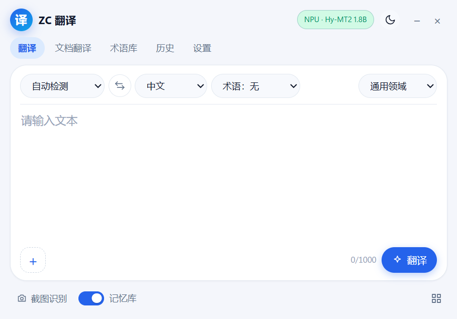

# ZC 오프라인 번역

ZC 오프라인 번역은 Windows에서 로컬로 실행되는 중국어·일본어·영어 번역 앱입니다. Tencent Hunyuan의 Hy-MT2 모델을 OpenVINO로 변환해 Intel NPU, GPU 또는 CPU에서 추론합니다. 화면은 pywebview로 만든 작은 창이고 백엔드는 FastAPI입니다. 번역 모델을 준비하고 음성 모델을 내려받을 때를 빼면 실행 중 네트워크를 쓰지 않으며, 원문과 번역문은 모두 로컬에 남습니다.

[简体中文](README.md) ｜ [English](README.en.md) ｜ [日本語](README.ja.md) ｜ **한국어** ｜ [Español](README.es.md)



## 기능

- 중국어·일본어·영어 6개 방향. 원문 언어는 자동으로 감지하거나 직접 지정할 수 있고, 번역 결과는 스트리밍으로 표시되어 언제든 취소할 수 있습니다.
- 스크린샷 번역은 Windows 기본 캡처 도구를 호출하고 로컬 OCR 결과를 원문 위치에 겹쳐 표시합니다. 이미지 번역도 같은 캔버스를 쓰며 확대와 이동을 지원합니다.
- 문서 번역은 TXT, Markdown, 스캔 PDF, DOCX를 지원합니다. 번역문은 원본 옆에 `원본이름_翻译`로 저장되고 원본 파일은 바뀌지 않습니다.
- 선택 영역 번역은 Windows UI Automation을 지원하는 앱에서 동작합니다. 글자를 선택하면 선택 영역 위에 번역 카드가 뜨며, Ctrl+C를 흉내 내거나 클립보드를 건드리지 않습니다.
- 음성 입력은 대화 모드와 받아쓰기 모드를 지원하며, sherpa-onnx의 SenseVoice와 Silero VAD를 사용합니다. 인식과 번역 모두 로컬에서 처리하고 음성 모델만 따로 내려받습니다.
- 용어집, 번역 메모리, 기록은 로컬 SQLite에 저장됩니다. 용어집은 CSV 가져오기/내보내기와 검색을 지원하고, 기록은 검색할 수 있으며, 번역 메모리는 자동으로 조회되고 설정에서 지울 수 있습니다.

## 시스템 요구 사항

- Windows 11 x64. Windows 10은 테스트하지 않았습니다.
- Microsoft Edge WebView2 Runtime(Windows 11에는 보통 기본 포함).
- Intel NPU, GPU 또는 CPU 중 하나. NPU를 쓰려면 Intel NPU 드라이버가 필요합니다.
- 메모리 16 GB 권장, 7B는 32 GB 권장.
- 디스크: 실행 환경 약 1.5 GB, 1.8B는 다운로드 약 4.1 GB·변환 후 약 2.2 GB, 7B는 다운로드 약 15 GB·변환 후 약 4.6 GB.
- 소스에서 실행하려면 Python 3.12.

## 다운로드

[Releases](https://github.com/2vkm2njr2y-droid/ZC-Translate/releases)에서 다음 중 하나를 받으세요.

- `ZCTranslate-0.1.2-win64-setup.exe`: NSIS 설치 프로그램. 현재 사용자에 설치하며 관리자 권한이 필요 없습니다.
- `ZCTranslate-0.1.2-win64-portable.zip`: 포터블 버전. 압축을 풀어 바로 실행하고 설정과 캐시는 폴더 안에 남습니다.
- `SHA256SUMS.txt`: 두 패키지의 체크섬.

두 패키지 모두 모델을 포함하지 않습니다. 설치 프로그램은 코드 서명이 없어 SmartScreen에서 "추가 정보 → 실행"을 눌러야 합니다. 포터블 사용법은 [docs/portable-usage.txt](docs/portable-usage.txt)(중국어)에 있습니다.

## 모델 준비

변환한 모델은 GitHub에 올리기에는 너무 커서 저장소와 릴리스 패키지에는 가중치가 들어 있지 않습니다. 처음 사용하기 전에 한 번 직접 준비해야 하며, 이 과정에서 네트워크를 한 번 사용합니다.

변환에는 저장소의 `.venv-convert` 환경이 필요합니다. 아직 없다면 다음 "소스에서 실행"에 있는 `scripts\setup_env.ps1`을 먼저 실행한 뒤(이 단계에서는 모델이 필요 없습니다) 돌아오세요.

```powershell
# 1.8B, 기본 프로필, NPU / GPU / CPU
.\.venv-convert\Scripts\python.exe scripts\prepare_model.py --profile balanced

# 7B, 고품질 프로필, GPU 또는 CPU 권장
.\.venv-convert\Scripts\python.exe scripts\prepare_model.py --profile quality
```

`准备模型.bat`을 더블클릭해도 됩니다(`--profile balanced`와 같은 동작).

스크립트는 ModelScope에서 Hy-MT2를 내려받아 OpenVINO IR로 변환하고 INT4 양자화를 적용한 뒤 `models/` 아래에 다음 구조를 만듭니다.

```
models/
└── hymt2-1.8b/
    ├── pack.json
    ├── LICENSE.txt
    ├── MODEL_CARD.md
    ├── ov-int4/          # GPU / CPU
    └── ov-int4-npu/      # NPU용. 대칭 양자화 필수
```

`ov-int4-npu`는 NPU용 대칭 INT4 변형입니다. 비대칭 양자화는 NPU에서 컴파일되지 않습니다. NPU는 처음 불러올 때 모델을 컴파일하므로 참고 장비 기준 약 10~15초 걸리고, 이후에는 `data/cache`에서 읽습니다.

모델 폴더는 다음 순서로 찾습니다: 환경 변수 `ZC_MODELS_DIR`, 프로그램 폴더의 `models/`, 실행 파일 옆의 `models-path.txt`, 데이터 폴더의 `models/`. 포터블 런처는 한두 단계 위 폴더도 확인합니다. 실행할 때 `--models-dir <경로>`를 넘겨도 됩니다.

포터블 버전은 `models`를 `ZCTranslate.exe` 옆에, 설치 버전은 `%LOCALAPPDATA%\ZCTranslate\models`에 둡니다. 두 방식 모두 `--models-dir`로 덮어쓸 수 있습니다.

수동 변환, 기존 OpenVINO IR 연결, 사용자 모델의 제한은 [docs/model-setup.md](docs/model-setup.md)(중국어)에 정리되어 있습니다.

## 소스에서 실행

```powershell
git clone https://github.com/2vkm2njr2y-droid/ZC-Translate.git
cd ZC-Translate

# 실행 환경과 모델 변환 환경. Python 3.12 필요
powershell -ExecutionPolicy Bypass -File scripts\setup_env.ps1

# 모델 준비(앞 절 참고)
.\.venv-convert\Scripts\python.exe scripts\prepare_model.py --profile balanced

# OCR과 스캔 PDF(선택)
powershell -ExecutionPolicy Bypass -File scripts\setup_ocr.ps1

# 실행
.\启动翻译器.bat
```

`run_dev.ps1`은 개발 모드로 콘솔 로그와 DevTools를 보여 줍니다.

테스트와 정적 검사:

```powershell
.\.venv-runtime\Scripts\python -m pytest tests -q
.\.venv-runtime\Scripts\python -m ruff check app tests
```

릴리스 빌드는 `scripts\build_release.ps1`, 아키텍처 설명은 [docs/architecture.md](docs/architecture.md)(중국어)에 있습니다.

## 사용법

실행하면 상태 표시줄에 현재 장치와 모델이 나옵니다. `Ctrl+Enter`로 번역하고 `Esc`로 취소합니다.

- 스크린샷 번역: 하단의 "截图翻译" 버튼 또는 `PrintScreen`. Windows 캡처 도구에서 "클립보드에 자동 복사"를 켜야 합니다.
- 문서 번역: "文档翻译" 탭에서 파일을 고릅니다. 긴 문서에는 1.8B를 권장합니다. 7B는 더 정확하지만 훨씬 느립니다.
- 선택 영역 번역: 설정에서 켭니다. 기본은 꺼져 있고 한 번에 4000자까지입니다.
- 용어집: CSV 열은 `source,target,case_sensitive,note`입니다.

자세한 사용법과 문제 해결은 [docs/user-guide.md](docs/user-guide.md)(중국어)를 참고하세요.

## 성능

참고 장비: HONOR JGC-N, Core Ultra X7 358H, 32 GB LPDDR5, Arc B390, Windows 11 25H2.

| 모델 | 장치 | 로드 시간 | 생성 속도(50 / 500자) |
|---|---|---:|---:|
| Hy-MT2 1.8B INT4 | NPU | 약 13.3초(캐시 후 약 1.4초) | 66 / 62 tok/s |
| Hy-MT2 1.8B INT4 | GPU | 약 4.2초 | 74 / 68 tok/s |
| Hy-MT2 1.8B INT4 | CPU | 약 2.8초 | 48 / 43 tok/s |
| Hy-MT2 7B INT4 | GPU | 약 8초 | 21 / 20 tok/s |
| Hy-MT2 7B INT4 | CPU | 약 6초 | 15 / 14 tok/s |

속도는 입력 길이, 드라이버, 백그라운드 부하에 따라 달라집니다. 전체 데이터와 평가 방법은 [docs/benchmark.md](docs/benchmark.md)와 [docs/evaluation.md](docs/evaluation.md)(중국어)에 있습니다.

## 알려진 제한

- 화면은 현재 중국어 간체만 지원합니다.
- 1.8B는 존댓말, 전문 용어, 긴 문장에서 누락되거나 어색한 표현이 나올 수 있습니다. 7B로 바꾸거나 용어집을 사용하세요.
- 7B는 NPU에 권장하지 않습니다. 긴 문서를 7B로 번역하면 수십 분 걸릴 수 있습니다.
- NPU는 처음 불러올 때 컴파일합니다. 드라이버나 모델을 바꾸면 다시 컴파일합니다.
- 선택 영역 번역은 UI Automation에 의존합니다. 자체 렌더링 UI, 게임, 관리자 권한 창, 암호 입력란에서는 선택을 읽지 못합니다.
- 설치 프로그램은 코드 서명이 없습니다. 설치 버전을 제거해도 `%LOCALAPPDATA%\ZCTranslate`의 설정, 기록, 모델은 남습니다.
- 기계 번역은 틀릴 수 있습니다. 법률, 의료, 금융, 문학 등의 내용은 사람이 검토하세요.

## 개인정보

FastAPI는 `127.0.0.1`에만 바인딩하고 실행할 때마다 일회용 토큰을 만듭니다. 로그에는 원문과 번역문을 남기지 않으며, 스크린샷은 메모리에서만 처리하고 임시 파일을 만들지 않습니다. 기록, 용어집, 번역 메모리는 한 번에 지울 수 있습니다.

## 라이선스

이 프로젝트는 GNU Affero General Public License v3.0(AGPL-3.0-only)으로 배포됩니다. Copyright (C) 2026 ZC Translate contributors. 라이선스 전문은 [LICENSE](LICENSE), 저작권과 보증 고지는 [NOTICE](NOTICE), 서드파티 구성 요소는 [THIRD_PARTY_NOTICES.md](THIRD_PARTY_NOTICES.md)를 참고하세요.

번역 모델 Hy-MT2는 Apache-2.0이며 이 저장소에 포함되지 않습니다. 음성 모델은 사용자가 앱 안에서 내려받으며, 라이선스는 각 모델 패키지를 따릅니다.

## 감사의 말

- [Tencent Hunyuan Hy-MT2](https://github.com/Tencent-Hunyuan/Hy-MT2): 번역 모델
- [Intel OpenVINO / OpenVINO GenAI](https://github.com/openvinotoolkit/openvino): 추론과 모델 변환
- [RapidOCR](https://github.com/RapidAI/RapidOCR) + [ONNX Runtime](https://github.com/microsoft/onnxruntime): 로컬 OCR
- [sherpa-onnx](https://github.com/k2-fsa/sherpa-onnx): 음성 인식과 VAD
- [pywebview](https://github.com/r0x0r/pywebview), [FastAPI](https://github.com/fastapi/fastapi), [Uvicorn](https://github.com/encode/uvicorn)

Issue와 PR은 환영합니다. `models/`, `dist/`, `data/`, 로그에 들어 있는 개인 정보는 커밋하지 마세요.
