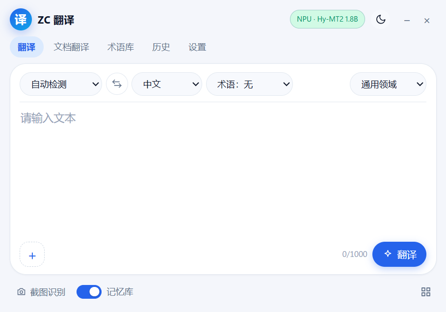

# ZC 离线翻译

ZC 离线翻译是一个在 Windows 上本地运行的中日英翻译工具。翻译模型用腾讯混元的 Hy-MT2，经 OpenVINO 转换后在 Intel NPU、GPU 或 CPU 上推理；界面是 pywebview 的小窗，后端用 FastAPI。除了准备翻译模型和下载语音模型，运行时不需要联网，原文和译文都留在本机。

**简体中文** ｜ [English](README.en.md) ｜ [日本語](README.ja.md) ｜ [한국어](README.ko.md) ｜ [Español](README.es.md)



## 功能

- 中日英六个方向互译，源语言可以自动检测，也可以手动指定。结果流式输出，能随时取消。
- 截图翻译调用 Windows 自带的截图工具，本地 OCR 识别后把译文盖在原文位置。图片翻译用同一套画布，可以缩放、拖动。
- 文档翻译支持 TXT、Markdown、扫描 PDF 和 DOCX。译文写在原文件旁边，文件名是 `原文件名_翻译`，原文件不会改动。
- 划词翻译在支持 Windows UI Automation 的程序里工作。选中文字后，选区上方会出现译文卡片，不模拟 Ctrl+C，也不改写剪贴板。
- 语音输入支持对话和听写两种模式，用 sherpa-onnx 的 SenseVoice 和 Silero VAD。识别和翻译都在本机完成，语音模型需要单独下载。
- 术语库、翻译记忆和历史记录都存在本机 SQLite 里。术语库支持 CSV 导入导出和搜索，历史记录可以搜索，翻译记忆会自动命中，也可以在设置里清空。

## 运行环境

- Windows 11 x64。Windows 10 没有测试过。
- Microsoft Edge WebView2 Runtime，Windows 11 一般自带。
- Intel NPU、GPU 或 CPU 任意一种。用 NPU 需要先安装 Intel NPU 驱动。
- 内存建议 16 GB；跑 7B 建议 32 GB。
- 磁盘空间：运行环境约 1.5 GB；1.8B 模型下载约 4.1 GB，转换后约 2.2 GB；7B 下载约 15 GB，转换后约 4.6 GB。
- 从源码运行需要 Python 3.12。

## 下载

到 [Releases](https://github.com/2vkm2njr2y-droid/ZC-Translate/releases) 下载：

- `ZCTranslate-0.1.2-win64-setup.exe`：NSIS 安装包，装在当前用户目录，不需要管理员权限。
- `ZCTranslate-0.1.2-win64-portable.zip`：便携版，解压就能用，设置和缓存留在包内。
- `SHA256SUMS.txt`：两个包的校验和。

安装包和便携版都不含模型。安装包没有代码签名，Windows SmartScreen 会拦一下，点“更多信息 → 仍要运行”即可。便携版的具体用法见 [docs/portable-usage.txt](docs/portable-usage.txt)。

## 准备模型

模型转换后体积太大，GitHub 放不下，所以仓库和发行包都不带权重，只带下载和转换脚本。第一次使用前需要自己准备，过程中要联网一次。

转换需要仓库里的 `.venv-convert` 环境。如果还没装，先执行下一节的 `scripts\setup_env.ps1`（这一步不用先准备模型），再回来执行：

```powershell
# 1.8B，默认档，NPU / GPU / CPU 都能用
.\.venv-convert\Scripts\python.exe scripts\prepare_model.py --profile balanced

# 7B，质量档，建议 GPU 或 CPU
.\.venv-convert\Scripts\python.exe scripts\prepare_model.py --profile quality
```

也可以双击 `准备模型.bat`，效果和 `--profile balanced` 一样。

脚本会从 ModelScope 下载 Hy-MT2，转成 OpenVINO IR，做 INT4 量化，然后在 `models/` 下生成这样的目录：

```
models/
└── hymt2-1.8b/
    ├── pack.json
    ├── LICENSE.txt
    ├── MODEL_CARD.md
    ├── ov-int4/          # GPU / CPU
    └── ov-int4-npu/      # NPU，必须是对称量化
```

`ov-int4-npu` 是 NPU 专用的对称 INT4 变体。非对称量化在 NPU 上会编译失败。第一次在 NPU 上加载需要编译模型，参考机上大约 10–15 秒，之后会走 `data/cache`。

程序按下面的顺序找模型目录：环境变量 `ZC_MODELS_DIR`、程序目录下的 `models/`、exe 旁边的 `models-path.txt`、数据目录下的 `models/`。便携版还会往上找一两级目录。也可以在启动时加 `--models-dir <路径>`。

便携版把 `models` 放在 `ZCTranslate.exe` 旁边；安装版放到 `%LOCALAPPDATA%\ZCTranslate\models`。两种方式都可以用 `--models-dir` 覆盖。

手动转换、接入已有的 OpenVINO IR、自定义模型的限制，见 [docs/model-setup.md](docs/model-setup.md)。

## 从源码运行

```powershell
git clone https://github.com/2vkm2njr2y-droid/ZC-Translate.git
cd ZC-Translate

# 运行环境和模型转换环境，需要 Python 3.12
powershell -ExecutionPolicy Bypass -File scripts\setup_env.ps1

# 准备模型，详见上一节
.\.venv-convert\Scripts\python.exe scripts\prepare_model.py --profile balanced

# OCR 和扫描 PDF，可选
powershell -ExecutionPolicy Bypass -File scripts\setup_ocr.ps1

# 启动
.\启动翻译器.bat
```

`run_dev.ps1` 是开发模式，会显示控制台日志并打开 DevTools。

测试和静态检查：

```powershell
.\.venv-runtime\Scripts\python -m pytest tests -q
.\.venv-runtime\Scripts\python -m ruff check app tests
```

打包用 `scripts\build_release.ps1`，架构说明见 [docs/architecture.md](docs/architecture.md)。

## 使用

打开程序后，状态栏会显示当前设备和模型。`Ctrl+Enter` 翻译，`Esc` 取消。

- 截图翻译：点底部的“截图翻译”，或按 `PrintScreen`。需要在 Windows 截图工具里打开“自动复制到剪贴板”。
- 文档翻译：在“文档翻译”页选择文件。长文档建议用 1.8B，7B 更准但慢很多。
- 划词翻译：在设置里打开，默认关闭，单次最多 4000 字。
- 术语库：CSV 的列是 `source,target,case_sensitive,note`。

完整操作和常见问题见 [docs/user-guide.md](docs/user-guide.md)。

## 性能

参考机：HONOR JGC-N，Core Ultra X7 358H，32 GB LPDDR5，Arc B390，Windows 11 25H2。

| 模型 | 设备 | 加载时间 | 生成速度（50 / 500 字） |
|---|---|---:|---:|
| Hy-MT2 1.8B INT4 | NPU | 约 13.3 秒（缓存后约 1.4 秒） | 66 / 62 tok/s |
| Hy-MT2 1.8B INT4 | GPU | 约 4.2 秒 | 74 / 68 tok/s |
| Hy-MT2 1.8B INT4 | CPU | 约 2.8 秒 | 48 / 43 tok/s |
| Hy-MT2 7B INT4 | GPU | 约 8 秒 | 21 / 20 tok/s |
| Hy-MT2 7B INT4 | CPU | 约 6 秒 | 15 / 14 tok/s |

速度会随输入长度、驱动和后台负载变化。完整数据和评测方法见 [docs/benchmark.md](docs/benchmark.md) 和 [docs/evaluation.md](docs/evaluation.md)。

## 已知限制

- 界面目前只有简体中文。
- 1.8B 在敬语、技术术语和长句上偶尔会漏译或措辞不自然，可以换 7B 或配术语库。
- 7B 不建议在 NPU 上跑；整本长文档用 7B 可能要几十分钟。
- NPU 首次加载需要编译；换驱动或换模型后会重新编译。
- 划词翻译依赖 UI Automation，部分自绘界面、游戏、管理员权限窗口和密码框读不到选区。
- 安装包没有代码签名；卸载安装版时会保留 `%LOCALAPPDATA%\ZCTranslate` 里的设置、历史和模型。
- 机器翻译可能出错，法律、医疗、金融、文学等内容请人工审校。

## 隐私

FastAPI 只监听 `127.0.0.1`，每次启动生成一个一次性 token。日志不记录原文和译文，截图只在内存里处理，不写临时文件。历史、术语库和翻译记忆都可以一键清空。

## 许可证

本项目以 GNU Affero General Public License v3.0（AGPL-3.0-only）发布，版权归 ZC Translate contributors 所有。许可证全文见 [LICENSE](LICENSE)，版权与担保声明见 [NOTICE](NOTICE)，第三方组件见 [THIRD_PARTY_NOTICES.md](THIRD_PARTY_NOTICES.md)。

翻译模型 Hy-MT2 使用 Apache-2.0，不随本仓库分发。语音模型由用户在应用内下载，许可证以模型包为准。

## 致谢

- [腾讯混元 Hy-MT2](https://github.com/Tencent-Hunyuan/Hy-MT2)：翻译模型
- [Intel OpenVINO / OpenVINO GenAI](https://github.com/openvinotoolkit/openvino)：推理和模型转换
- [RapidOCR](https://github.com/RapidAI/RapidOCR) + [ONNX Runtime](https://github.com/microsoft/onnxruntime)：本地 OCR
- [sherpa-onnx](https://github.com/k2-fsa/sherpa-onnx)：语音识别和 VAD
- [pywebview](https://github.com/r0x0r/pywebview)、[FastAPI](https://github.com/fastapi/fastapi)、[Uvicorn](https://github.com/encode/uvicorn)

有问题欢迎提 Issue。提交前请确认不要带上 `models/`、`dist/`、`data/` 或日志里的个人内容。
